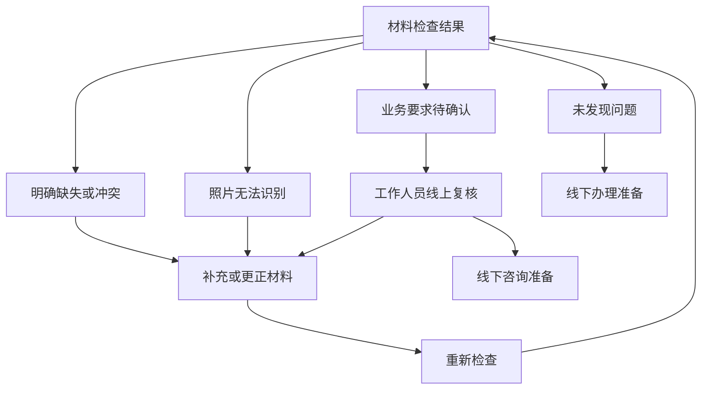

# 社区政务材料预审系统：前端完整设计

版本：V1.0  
编制日期：2026-10-10  
适用项目：事项材料查询、材料预审、工作人员线上复核、线下办理准备。  
文档性质：可用于页面设计、前后端接口讨论、任务拆分和参赛演示的设计方案；本文不代表真实政务办理规定，也不表示功能已实现。

## 1. 产品目标与设计边界

居民能够知道办理事项需要什么材料、材料从哪里获取、自己准备的材料有哪些问题，以及下一步应如何补充或咨询。工作人员能够直接看到疑问、证据和规则依据，减少翻找材料和重复解释的时间。

系统的输出是材料准备与预审建议。正式受理、材料真实性核实和审批结论由有权限的业务部门决定。

### 1.1 用户与终端

| 角色 | 主要目标 | 推荐终端 | 权限边界 |
| --- | --- | --- | --- |
| 未登录访客 | 查询公开事项和办理指南 | 手机网页、电脑网页 | 仅查看已发布的公开信息 |
| 居民/办件创建人 | 创建办件、上传材料、查看结果、请求复核 | 手机优先的响应式网页；后续小程序 | 查看自己的或明确授权的办件 |
| 工作人员 | 领取任务、定位疑问、确认与反馈 | 电脑网页 | 查看分配或授权的办件 |
| 配置管理员 | 维护事项、材料、问卷、规则与来源 | 电脑网页 | 管理配置；配置权限不自动等于材料查看权限 |

登录账户和业务参与人不同。例如用户替父母准备材料，账户使用者不一定是申请人。前端需要明确展示“账户创建人、申请人、代办人”的区别，具体可代理情形以事项要求为准。

### 1.2 版本划分

- **P0：第一版必须完成**。一个事项、一个完整办件闭环、居民端和工作人员端、必要配置管理。
- **P1：闭环稳定后完善**。证据定位、更多事项、批量配置、版本差异、统计和通知。
- **P2：后续扩展**。小程序、语音辅助、复杂规则编辑器、真实预约或部门数据对接。

P0也必须处理错误、权限和重复提交。扩展优先级不意味着可以忽略基础安全与异常处理。

## 2. 总体信息架构

### 2.1 居民端

手机底部导航建议采用“事项查询 / 我的办件 / 我的”。办件内部使用步骤导航：情形确认、材料准备、材料检查、复核与补正、线下准备。智能问答放在事项详情或报告页作为辅助入口。

| 页面 | 路由示例 | 优先级 |
| --- | --- | --- |
| 事项列表 | `/services` | P0 |
| 事项详情 | `/services/:matterId` | P0 |
| 登录 | `/login` | P0 |
| 我的办件 | `/applications` | P0 |
| 情形问卷与参与人 | `/applications/:id/scenario` | P0 |
| 个性化材料清单 | `/applications/:id/checklist` | P0 |
| 材料上传与详情 | `/applications/:id/documents` | P0 |
| 识别信息确认 | `/applications/:id/fields` | P0，先支持关键字段 |
| 预审进度 | `/applications/:id/checks/:runId/progress` | P0 |
| 预审报告 | `/applications/:id/checks/:runId/report` | P0 |
| 复核记录 | `/applications/:id/reviews` | P0 |
| 线下办理准备 | `/applications/:id/preparation` | P0 |
| 消息中心与个人设置 | `/messages`、`/profile` | P1；P0保留基础退出登录 |

### 2.2 工作人员端

| 页面 | 路由示例 | 优先级 |
| --- | --- | --- |
| 复核任务队列 | `/staff/tasks` | P0 |
| 复核工作台 | `/staff/tasks/:taskId` | P0 |
| 已处理任务 | `/staff/history` | P0 |
| 工作统计 | `/staff/dashboard` | P1 |

### 2.3 管理端

| 页面 | 路由示例 | 优先级 |
| --- | --- | --- |
| 事项与版本管理 | `/admin/matters` | P0，允许简化 |
| 材料要求管理 | `/admin/matters/:id/materials` | P0 |
| 问卷管理 | `/admin/matters/:id/questions` | P0，可先配置导入 |
| 规则管理 | `/admin/matters/:id/rules` | P0，可先配置导入 |
| 政策来源管理 | `/admin/sources` | P0 |
| 获取渠道与办理地点 | `/admin/locations` | P0 |
| 发布预览与测试 | `/admin/matters/:id/publish` | P0，先做简单预览 |
| 角色、审计与运行统计 | `/admin/access`、`/admin/audit`、`/admin/metrics` | P1；P0后台仍须执行权限校验与关键审计 |

路由只是页面组织建议，不等于后端API，也不要求采用完全相同的命名。

## 3. 居民端完整操作流程

1. 不登录即可查询公开事项，查看官方材料要求与办理地点。
2. 点击“准备材料”，登录后创建预审办件。
3. 确认申请人和必要参与人，填写情形问卷。
4. 系统展示适用于当前情形的材料清单。
5. 用户按清单上传材料，或标记需现场出示、部门获取等准备状态。
6. 后台识别材料，用户核对关键字段。
7. 用户点击“开始材料检查”，系统执行预审并生成报告。
8. 对明确问题补传，对看不清的照片重拍，对业务疑问请求人工复核。
9. 工作人员给出反馈，用户按反馈处理后重新检查。
10. 用户查看线下准备清单，携带要求的原件或复印件前往指定地点。

### 3.1 有效的分支与闭环



线上复核完成并不一定意味着问题全部解决；复核结果应明确“需补充什么”或“为何需线下核实”。

## 4. 居民端页面详细设计

### 4.1 事项查询页

**展示内容**：事项名称、服务区域、简要用途、办理机构、是否已支持材料预审、信息核对日期。

**交互**：关键词搜索、按类别和区域筛选、进入详情。P0使用数据库关键词查询即可，不必先上语义检索。

**异常**：无结果时提示调整关键词或区域；未支持预审的事项仍可展示指南，但不能展示可用的预审入口。

### 4.2 事项详情页

| 模块 | 内容 |
| --- | --- |
| 事项概况 | 名称、适用区域、受理机构、指南描述 |
| 情形说明 | 哪些人或哪些办理情况适用；无法确认时咨询渠道 |
| 通用材料 | 材料名称、条件要求、原件/复印件、份数和提交方式 |
| 材料获取 | 获取渠道、步骤、地点、官方链接及已有来源中的信息 |
| 业务办理 | 最终受理地点、服务时间、官方联系电话；预约仅在真实支持时展示 |
| 信息依据 | 官方指南链接、来源单位、配置版本、核对日期 |
| 操作入口 | “根据我的情况生成清单”“开始准备材料” |

尚未填写问卷时，材料清单标记为“通用说明，填写情形后确认”。不把模型猜测的地址、时间或材料要求展示为官方信息。

### 4.3 登录与办件创建页

- 公开查询无需强制登录；保存办件、上传材料和申请复核需要登录。
- 延续现有后端支持的登录方式。短信、微信登录只在完成真实接入后启用。
- 演示账户明确标为演示用途，不能使用固定测试身份冒充真实身份认证。
- 登录后返回原事项或原操作位置。
- 创建办件时显示事项、区域、使用的指南版本，并提供“继续已有草稿”入口。
- 重复点击创建按钮应返回同一请求对应的办件，后端提供幂等保障。

### 4.4 情形问卷与参与人页

**目的**：确定适用材料与规则，不作为真实身份或资格证明。

| 问题类别 | 问题示例 | 对清单的影响 |
| --- | --- | --- |
| 办理类型 | 首次办理、变更、补办等 | 选择对应材料分支 |
| 办理方式 | 本人办理还是他人代办 | 是否需要代办相关信息或材料 |
| 申请人情形 | 是否存在事项规定的特殊情形 | 启用对应条件材料 |
| 材料持有情况 | 是否已有某项材料 | 生成获取建议，不能直接认定材料符合要求 |
| 不确定回答 | “不清楚，需工作人员确认” | 保留待确认项，不强行推断 |

上述为设计示例，实际问题必须由选定事项的官方要求决定。不要为所有事项固定询问婚姻、收入、家庭关系等信息。

**表单规则**：问题按情形动态显示；必要问题标注必填；每个问题附“为什么需要回答”；自动保存草稿并显示保存状态；隐藏分支旧答案不参与当前清单计算，但可留作历史。

**参与人**：按事项需要添加申请人、代办人等，展示角色和必要字段。材料上传时关联具体人员，避免将不同人员的字段误判为冲突。

**问卷修改**：已有材料后修改情形，先展示清单变化。保留旧材料，提示新增必需项和当前不再适用项，并要求重新预审。问卷提交版本与每次预审结果对应。

### 4.5 个性化材料清单页

每张材料卡片包含：材料名称、适用原因、必需/条件/替代关系、所属人员、格式与页数要求、提交方式、获取方式和准备状态。

| 状态 | 说明 | 推荐按钮 |
| --- | --- | --- |
| 待准备 | 目前尚未提供或确认准备状态 | 查看获取方法 |
| 待上传 | 当前项目支持并要求上传 | 上传材料 |
| 已上传 | 文件已保存，尚不代表符合要求 | 查看文件 |
| 待确认 | 情形或材料内容不确定 | 查看问题 |
| 待补充 | 最新报告指出缺失或错误 | 补充材料 |
| 当前检查未发现问题 | 当前版本已完成对应核验 | 查看检查依据 |
| 现场出示 | 按要求现场携带，线上不要求上传 | 标记已准备 |
| 部门获取 | 按指南由部门获取 | 查看说明 |

“我已准备”是用户声明，不能自动改为“检查通过”。尚未完成真实部门接口对接时，不显示“部门已获取”。

**材料替代关系**：例如官方允许两种证明任选其一时，展示为同一要求下的两个选项，避免计算成两项缺失。关联人员不同的同类材料分别展示。

**获取方法抽屉**：先显示操作步骤，再显示具体获取地点/官方入口，最后显示来源。最终办理地点另设模块，避免混淆。

### 4.6 材料上传与预览页

**P0能力**：手机拍照、选择图片/PDF、多页追加、预览、删除草稿、替换已上传版本、查看上传进度和重试。

| 校验 | 前端作用 | 后端作用 |
| --- | --- | --- |
| 文件类型与大小 | 及时提示限制 | 重新检查，不能信任前端 |
| 页数与正反面 | 展示事项要求并提示漏传 | 根据配置与解析结果检查 |
| 图像质量 | 提示反光、模糊、裁切风险 | 生成质量检查结果 |
| 重复文件 | 提示可能重复 | 根据文件摘要与业务上下文判断 |
| 文件安全 | 使用受控预览组件 | 验证文件实际类型与访问权限 |

文件大小、页数、支持格式采用后端配置值，不在页面与服务端各写一套不同限制。

上传前明确材料名称和所属人员。自动分类结果不确定时，让用户确认；不要静默移动至另一材料项。

已提交材料替换后生成新版本，旧报告仍可查看旧版本依据。文件摘要不等于材料真实性认证。上传成功和OCR成功是两个独立状态。

失败时保留已成功页面，允许仅重试失败部分。避免为压缩图片而使小字号文字不可识别。

### 4.7 识别信息确认页

电脑采用原图与字段双栏；手机先显示字段卡片，点击字段打开对应图片。

每个关键字段展示：名称、识别值、关联人员、来源材料、页码、可定位的文字区域，以及“正确/修改/无法确认”操作。

用户修改的内容作为纠正记录保留，不能覆盖原始识别文本，也不能等同于工作人员已确认。关键字段缺失时显示“未识别到”，不让模型编造。

证件号码在列表中脱敏；授权用户需要核对时，可通过明确操作在受控页面查看。OCR分数主要辅助处理，不作为面向居民的“材料可信度”。

### 4.8 预审进度页

阶段：任务排队、读取材料、文字识别、字段整理、规则核验、报告生成。

- 展示真实阶段与已完成材料数量，不能使用虚假倒计时。
- 后端未提供可测算进度时，使用阶段状态，不显示虚假的百分比。
- 页面可退出，任务在后台继续；用户可从“我的办件”返回。
- 失败提示可理解的原因，并提供重试；不向用户显示服务密钥、堆栈或内部提示词。
- 多次点击检查按钮避免重复任务；新材料上传期间的旧检查，不覆盖最新结果。

### 4.9 预审报告页——核心页面

**顶部摘要**：事项、申请人、报告时间、材料版本、指南版本、本次检查覆盖范围；明确“材料预审建议，正式办理以受理部门核验为准”。

| 结果类别 | 居民可理解的表述 | 后续操作 |
| --- | --- | --- |
| 未发现问题 | 本次已执行检查未发现问题 | 查看线下准备 |
| 明确缺失 | 尚缺某材料或某页 | 获取并补传 |
| 字段冲突 | 两份材料中的同一人员信息不同 | 核对原图与识别值 |
| 日期或格式问题 | 已配置规则检查未满足要求 | 查看依据并补充 |
| 无法识别 | 某部分看不清，暂不能判断 | 重拍、补传 |
| 业务待确认 | 条款或情形需工作人员判断 | 请求人工复核 |
| 检查异常 | 系统未完成某项检查 | 重试或请求帮助 |

不适用的规则标记为“当前情形不适用”，不计入成功核验数量。不要把检查异常展示为材料不符合要求。

**问题卡片必须包含**：发生位置、发现内容、涉及材料/人员、规则依据、建议动作和操作入口。

**虚构演示示例**：

> 申请人姓名待核对。材料A识别为“张三”，材料B识别为“张山”。请先对照原图确认是否为识别错误。若识别正确，请按事项要求确认材料信息。可修改识别结果或申请工作人员复核。

模型解释只基于已有问题和来源生成；“获取新证明”“前往某地址”等建议必须有已核对的业务信息支持。

**底部操作**：补充材料、申请复核、查看历史报告、查看线下准备。允许材料不齐时检查现有材料，同时明确本次属于部分检查，不能标记整体材料无误。

### 4.10 人工复核页

- 默认带入已选择的问题、相关材料、报告编号和用户备注。
- 用户可说明疑问，但无需重新上传已经存在的文件。
- 展示待领取、处理中、需用户补充、已反馈或建议线下核实。
- 按问题展示回复、依据、明确动作、处理时间和工作人员显示身份。
- 新材料上传后，旧复核记录仍对应旧材料；提示是否提交更新后的材料进行复核。
- 已有活动任务时提供“补充说明”，避免同一问题反复提交多个任务。

若项目尚无真实工作人员参与，展示“演示复核”，不承诺真实服务时效，也不把演示反馈称为官方确认。线上处理时间仅在有实际服务约定时显示。

### 4.11 我的办件页

卡片显示事项名称、必要的人员标识、最近更新、最新状态和下一步按钮。

筛选建议：草稿、准备中、检查中、待补正、待复核、可查看线下准备、已归档。状态应由后端按当前数据和任务计算。

不把“去线下办理”自动记录为“已办结”。没有真实业务系统结果时，最多允许用户标记“个人记录：已办理”。

### 4.12 线下办理准备页

展示原件/复印件与份数要求、现场填写项、最终受理地点、服务时间、官方联系方式、未解决问题和报告日期。

提供可打印的准备清单。报告二维码若后续实现，应使用授权或短期令牌，不能把个人材料变成公开链接。

问卷或材料变更、指南更新后展示“需重新确认准备清单”。P0使用打印样式即可，PDF导出放P1。

## 5. 工作人员端详细设计

### 5.1 复核任务队列

列表字段：任务编号、事项、疑问类型、提交时间、等待时长、处理状态、当前负责人、需复核材料数。

筛选：事项、疑问类型、任务状态、提交日期。默认按等待时间或实际业务优先级排序，不根据模型猜测居民重要程度。

“领取任务”由后端原子处理。被他人领取时提示刷新，不能仅依靠前端禁用按钮。

### 5.2 复核工作台——核心页面

电脑布局建议采用三栏：

| 左栏：任务与问题 | 中栏：材料证据 | 右栏：依据与处理 |
| --- | --- | --- |
| 事项、情形答案、人员角色、疑问列表 | 原图/PDF、页码、缩放、字段区域、跨材料对照 | 官方来源、规则说明、处理动作、反馈编辑 |

点击问题后同时定位对应材料页、字段与规则来源。初始仅展开疑问材料，允许查看其他授权材料。

**复核动作**：

1. 确认识别值或纠正识别错误。
2. 请求补充指定材料、页面或信息。
3. 对当前问题给出复核意见及依据。
4. 说明需要线下核实的原因和咨询地点。
5. 提交结果，形成独立的复核记录。

不能通过一个“全部通过”按钮掩盖未检查问题。工作人员修改字段后触发新检查或提示需重新检查，旧报告保持可追溯。

模型可生成问题摘要与回复草稿，但提交前由工作人员确认。缺少来源时保留待确认，不能凭生成文本补出办理要求。

### 5.3 并发与版本冲突

- 工作人员打开页面后用户补传材料，工作台提示“材料已更新”，不得无提示提交旧版本结论。
- 允许查看旧版本并说明结论适用范围；需要核验新版本时刷新证据或创建后续任务。
- 两名工作人员同时提交时，服务端执行版本检查，失败的一方显示冲突原因并保留草稿。
- 任务领取、转交、反馈和字段纠正记录操作者与时间。

### 5.4 历史与工作统计

历史页展示已处理任务、复核动作、关联报告及反馈。统计建议包括：待处理数量、复核耗时、常见问题、重拍率、补传后问题减少情况。

演示数据与真实业务数据分开标识；实际效率提升需要人工对照实验或试用数据，不能直接用页面计数宣称已经提升。

## 6. 管理端详细设计

### 6.1 事项配置

配置事项名称、区域、机构、指南来源、版本、生效日期与发布状态。编辑草稿不影响已经创建的办件。

已发布版本不可直接改写；修改后创建新版本。已有办件使用固定版本，升级需要显示变化并重新生成清单和报告。

### 6.2 材料要求配置

配置材料类型、适用条件、关联人员角色、份数、原件/复印件、上传方式、替代关系、获取渠道与需抽取字段。

材料类型表达“这是什么证明或表单”，纸质/电子、原件/复印件和上传方式分别配置。

### 6.3 问卷与规则配置

问卷：问题编码、题干、选项、必填条件、显示条件、说明、来源。

规则：适用情形、输入字段、人员范围、允许的比较操作、边界条件、依据、失败解释和不确定处理方式。

P0可使用固定操作符表单或导入JSON。前端不允许自由输入任意Python/SQL作为规则。

### 6.4 模型辅助配置与发布

流程：上传/导入官方文本 → 模型生成候选材料和条件 → 管理员对照来源核对 → 测试预览 → 发布版本。

发布前检查：来源是否可追溯、问卷条件是否有效、材料替代关系是否合理、规则字段是否存在、地点是否已核对、测试情形是否能生成完整清单。

“模型已提取”与“管理员已确认”使用不同状态，只有确认后的配置参与居民材料检查。

## 7. 状态、版本与跨页面一致性

### 7.1 不混用的四类状态

| 状态对象 | 示例 | 不能推导出的结论 |
| --- | --- | --- |
| 文件上传 | 上传中、已上传、失败 | 已上传不等于内容已识别 |
| 解析任务 | 排队、处理中、成功、失败 | 解析成功不等于材料符合要求 |
| 核验结果 | 未发现问题、有问题、无法确定、异常 | 未发现问题不等于正式审批通过 |
| 人工任务 | 待领取、处理中、需补充、已反馈 | 已反馈不等于所有材料已准备完善 |

首页卡片展示综合状态，详情保留各维度状态。所有页面通过统一状态映射组件显示文本、图标和颜色。

### 7.2 版本展示规则

- 报告绑定本次情形答案、材料版本、字段版本与规则版本。
- 上传新材料或修改问卷后，旧报告增加“对应旧材料/旧情形”的提示。
- 异步任务完成时，仅在其输入仍为当前版本时更新“最新结果”。
- 页面刷新、重新登录后，状态从后端恢复，不依赖浏览器临时变量。

## 8. 模型与前端的关系

模型由后端或后台处理服务调用，前端通过业务API获得状态和结果。前端不保存模型密钥，不直接把用户文件发送至未配置的数据接收方。

| 模型功能 | 前端入口 | 展示结果 |
| --- | --- | --- |
| OCR与图像质量检查 | 材料上传 | 识别状态、重拍建议 |
| 材料分类与字段抽取 | 材料详情、字段确认 | 材料类别、字段候选与证据位置 |
| 政策条件提取 | 管理端 | 条件草稿与原文对照 |
| 问题解释 | 预审报告 | 基于规则结果的补正说明 |
| 复核摘要 | 工作台 | 工作人员可编辑的摘要与回复草稿 |
| 政策语义检索 | 事项搜索或辅助问答 | 可核对的来源段落 |

对于日期、必需材料、同一人员字段一致性等确定条件，由规则引擎判断。模型失败时保留已完成的识别与检查结果，并明确哪些部分没有完成。

## 9. 前后端接口契约建议

以下为建议接口，不代表现有后端已经实现。落地时统一字段命名、鉴权、分页和错误结构，再生成前端类型。

| 业务 | 方法与路径示例 | 关键返回内容 |
| --- | --- | --- |
| 事项列表 | `GET /api/v1/matters` | 事项、区域、预审支持状态 |
| 事项详情 | `GET /api/v1/matters/{id}` | 已发布指南、来源、通用要求 |
| 创建办件 | `POST /api/v1/applications` | 办件ID、版本、状态 |
| 我的办件 | `GET /api/v1/applications` | 授权范围内的分页列表 |
| 获取问卷 | `GET /api/v1/applications/{id}/questionnaire` | 问题、当前答案、显示条件 |
| 保存情形 | `PUT /api/v1/applications/{id}/scenario` | 新数据版本、清单变化 |
| 获取清单 | `GET /api/v1/applications/{id}/checklist` | 要求、人员、替代组、准备状态 |
| 上传材料 | `POST /api/v1/applications/{id}/documents` | 文档/版本ID、上传状态 |
| 获取识别结果 | `GET /api/v1/documents/{id}/extractions` | 字段、页码、位置、解析状态 |
| 纠正字段 | `POST /api/v1/applications/{id}/field-corrections` | 纠正记录、新数据版本 |
| 发起检查 | `POST /api/v1/applications/{id}/checks` | 检查任务ID、输入版本、任务状态 |
| 查询检查 | `GET /api/v1/checks/{runId}` | 阶段、错误、完成时的报告信息 |
| 查看报告 | `GET /api/v1/checks/{runId}/report` | 问题、依据、证据与下一步动作 |
| 请求复核 | `POST /api/v1/applications/{id}/review-tasks` | 任务ID、范围、状态 |
| 查询复核 | `GET /api/v1/applications/{id}/review-tasks` | 任务与反馈 |
| 领取任务 | `POST /api/v1/staff/tasks/{id}/claim` | 当前分配与版本 |
| 提交复核 | `POST /api/v1/staff/tasks/{id}/records` | 记录、任务状态、是否需重新检查 |
| 线下准备 | `GET /api/v1/applications/{id}/preparation` | 携带清单、地点、待确认项 |

### 9.1 通用约定

- 错误结构包含稳定错误码、用户可理解的提示、字段错误和请求追踪ID；不输出敏感服务信息。
- 创建、检查和领取操作提供后端幂等或冲突保护。
- 返回可用动作，如`can_upload`、`can_request_review`；服务端仍必须执行权限校验。
- 列表响应分页；图片使用授权访问或短期访问链接，不公开文件存储键。
- 修改问卷、材料和复核记录携带当前版本，服务端检测过期操作。
- 长耗时模型任务异步处理。P0可轮询状态，完成后停止；P1考虑事件推送。
- 识别区域坐标明确相对于原图的归一化坐标，前端缩放时正确换算。页面旋转也需要同步变换区域。
- 日期和业务时区统一约定，显示日期不能替代后端对有效期边界的计算。

## 10. 前端工程组织建议

优先沿用已经启动的全栈模板所使用的前端技术和组件库，避免同时更换框架。下面是目录职责建议，不要求逐字照搬。

```text
src/
  app/                 路由、登录状态、角色入口
  features/
    matters/           事项查询与详情
    applications/      办件与情形问卷
    documents/         上传、版本、字段确认
    checks/            进度、报告、历史
    reviews/           用户复核与工作人员任务
    administration/    事项、来源、规则配置
  components/          共用展示与输入组件
  api/                 业务请求封装与生成类型
  domain/              状态映射、前端展示类型
  styles/              响应式布局与打印样式
```

### 10.1 优先复用的组件

| 组件 | 作用 |
| --- | --- |
| `MatterCard` | 事项列表展示 |
| `ScenarioForm` | 按配置渲染问卷与条件分支 |
| `MaterialRequirementCard` | 材料要求、人员与准备状态 |
| `DocumentUploader` | 多页上传与失败重试 |
| `DocumentViewer` | 图片/PDF预览、缩放和证据定位 |
| `ExtractedFieldCard` | 字段、来源与纠正动作 |
| `CheckIssueCard` | 问题、依据与后续操作 |
| `PolicySourcePanel` | 来源原文与版本 |
| `ReviewTimeline` | 复核与补传历史 |
| `StatusBadge` | 统一状态文本、图标和颜色 |
| `EmptyState`、`ErrorState` | 空数据、失败、重试 |
| `PreparationChecklist` | 屏幕与打印准备清单 |

业务判断由后端执行。前端只做输入提示和交互校验，不能自行修改报告结论。服务器数据和未提交表单分开管理，避免刷新接口覆盖用户正在编辑的内容。

### 10.2 响应式与小程序扩展

第一版居民端以手机网页为主要体验，工作人员与管理员以电脑网页为主。三端共享后端能力与数据契约，但不强行共享所有页面布局。

后续小程序复用API、状态与业务流程；拍照、登录、通知和文件预览通过平台能力重新适配。网页组件不能直接假定可原样搬到小程序。

## 11. 可用性、隐私与异常场景

### 11.1 面向居民的可用性

- 用“缺哪份材料、哪里看不清、下一步怎么做”表达问题，不直接显示内部规则码。
- 关键操作使用明确动词，支持大字体、键盘操作和屏幕阅读器标签。
- 状态同时使用文字和图标，不仅用红绿颜色区分。
- 不必要的信息不收集；同一字段不重复填写，已有识别值可供确认。
- 支持草稿保存、上传重试和中断后继续。
- 低速网络下优先加载清单和问题摘要，原图按需加载。

### 11.2 访问与数据处理

前端隐藏按钮不能代替后端鉴权。文件预览、导出和证据链接同样校验权限。登出清除敏感缓存；不把完整证件号和材料内容放进URL、公共日志或分析埋点。

上传前说明材料用途和适用的数据处理方式。删除/归档提供明确入口，实际保留规则由后端和项目运营方案决定。

### 11.3 必须覆盖的异常

| 场景 | 前端行为 |
| --- | --- |
| 登录过期 | 提示重新登录并恢复可恢复的非敏感操作上下文 |
| 无权查看办件 | 显示无权限，不能泄露材料或对象详情 |
| 文件上传部分失败 | 保留成功页，单独重试失败部分 |
| OCR失败 | 展示失败材料，允许重试或重拍 |
| 模型超时 | 保留任务状态，允许稍后查看；不伪造结果 |
| 修改问卷后材料要求变化 | 展示清单差异并要求重新检查 |
| 报告使用旧材料 | 明确旧版本标识与重新检查入口 |
| 工作人员任务被他人领取 | 更新负责人并提示刷新 |
| 复核过程中材料更新 | 提示版本变化，阻止无提示提交旧结论 |
| 政策版本发生变化 | 展示变化与确认入口，不静默迁移 |
| 暂无真实复核服务 | 明确演示性质，不承诺真实反馈 |

## 12. 开发顺序与可交付成果

### 阶段一：数据与页面骨架

选定一个事项，录入已核对的指南、问卷、材料和地点。完成登录、角色路由、事项详情、我的办件和公共组件。

**交付**：可以查询事项、创建并恢复草稿，三种角色看到各自入口。

### 阶段二：清单与上传

完成情形问卷、参与人、个性化清单、多页上传、预览与版本状态。

**交付**：不同情形生成不同清单，材料能保存并重新打开。

### 阶段三：模型结果与预审报告

接入真实OCR/抽取结果、字段纠正、异步检查、问题报告和证据定位。

**交付**：正常、缺失、冲突、模糊材料分别出现可解释的结果。接口未完成期间可以用Mock开发界面，但演示验收需区分Mock和真实处理。

### 阶段四：复核与补正闭环

完成任务申请、领取、工作人员工作台、反馈、补传和重新检查。

**交付**：用户和工作人员在不同账户下完成一次真实系统交互，不靠手工修改数据库推动状态。

### 阶段五：发布管理与参赛演示

完善来源版本、简单管理表单、打印准备清单、异常状态和演示脚本。第二个事项通过配置复用页面与流程。

**交付**：完整演示录像、可操作环境、测试记录、指标说明及真实/合成数据标识。

## 13. 页面验收清单

### 13.1 居民端

- [ ] 访客可以查公开指南，开始保存办件时再登录。
- [ ] 问卷按当前情形显示，回答不确定时不强行推断。
- [ ] 同类材料按人员分别关联，替代材料不会重复计算缺失。
- [ ] 每项材料能查看获取方法和来源，最终办理地点单独展示。
- [ ] 多页文件可上传、预览、替换和失败重试。
- [ ] 能对照原图纠正关键识别字段。
- [ ] 上传状态、解析状态和核验结果区别清楚。
- [ ] 报告每个问题都给出位置、依据和下一步动作。
- [ ] 部分检查、旧版本报告和系统异常不会展示为整体材料无误。
- [ ] 补传后可以重新检查，历史结果仍可追溯。
- [ ] 能申请复核并查看反馈，未接入真实服务时有演示标识。
- [ ] 能查看和打印线下准备清单。

### 13.2 工作人员与管理员

- [ ] 工作人员只能读取授权任务与材料。
- [ ] 两人同时领取任务时只能有一人成功。
- [ ] 点击疑问可定位原图与规则来源。
- [ ] 模型回复草稿必须经工作人员确认才提交。
- [ ] 用户补传后工作台能发现版本变化。
- [ ] 复核记录不能无痕覆盖旧结论。
- [ ] 管理员能维护一个事项的完整配置并预览清单。
- [ ] 发布后版本保持稳定，新配置不会静默改变旧办件。
- [ ] 修改另一事项配置即可复用同一前端流程。

### 13.3 推荐验证方式

使用合成办件覆盖：正常材料、缺材料、字段冲突、有效期边界、模糊图片、不同人员同名、多页漏传、替代材料、上传失败、并发领取和过期报告。

合成材料用于功能与技术测试，不能直接证明真实办理成功率。人工复核耗时通过有无证据定位的对照操作测量，报告中说明样本量与测试条件。

## 14. 参赛展示建议

围绕一个用户的连续故事演示：查询事项 → 情形生成清单 → 上传材料 → 定位缺失与冲突 → 对照原图纠正 → 工作人员复核 → 补传重新检查 → 线下准备。

随后展示第二种情形或第二个事项，通过配置改变清单和规则，证明框架可复用。最后展示真实测得的字段准确率、错误放行情况、复核耗时与处理延迟。

项目亮点落在三处：材料要求能够追溯来源，问题能够定位到证据，用户补正与工作人员复核能够形成完整闭环。模型数量、页面数量和技术名称不代替这些能力。

## 15. 第一版最小页面组合

如果开发时间有限，将页面适当合并，而不是取消关键步骤：

1. **事项查询与详情**：公开指南、地点和来源。
2. **我的办件**：创建、继续、查看当前状态。
3. **办件准备页**：问卷、参与人、清单、上传和字段确认分区。
4. **检查报告页**：进度、问题、证据、补传与复核入口。
5. **复核与线下准备页**：反馈时间线、携带清单和地点。
6. **工作人员任务页**：待处理与历史任务。
7. **工作人员复核工作台**：原图、字段、依据和处理动作。
8. **管理员配置页**：事项、来源、材料、问卷、规则和发布预览。

这八类页面足以承载第一版完整流程。后续再拆分复杂页面、扩展事项与小程序。
