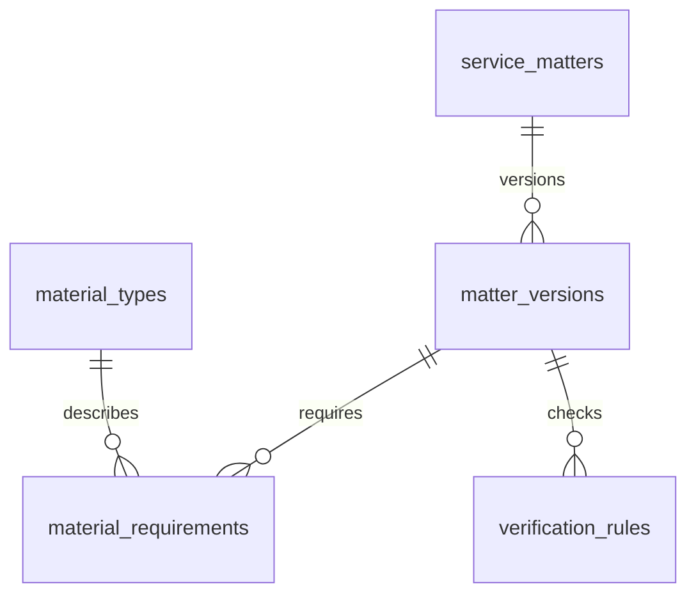
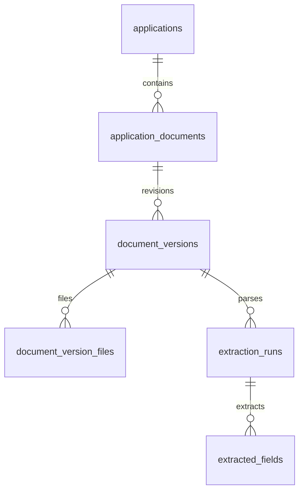
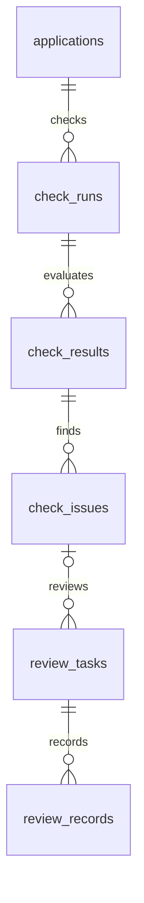

# 社区政务材料预审系统：数据库详细设计
> 设计日期：2026年10月10日；版本：建议稿 v1.0  
> 面向：多事项材料清单查询、智能预审、人工复核、线下办理准备  
> 数据库：按PostgreSQL设计，复用现有FastAPI项目的账号和迁移机制  
> 本文是逻辑与物理设计说明，不是已经执行的建库脚本。具体迁移前须核对现有模型、实际表名与数据库版本。本文不直接改动现有系统。

## 1. 设计目标与概念

不同事项使用不同问卷、材料要求、字段和规则，但共用上传、解析、核验、报告、复核流程。数据库保存业务差异，执行器提供可复用能力。

| 概念 | 含义 | 示例（虚构） |
|---|---|---|
| 事项 | 一种业务类别 | 测试补贴申请 |
| 事项版本 | 某时点已确认的整套业务配置 | 该事项第1版 |
| 办件 | 某居民的一次准备过程 | 父亲此次申请，子女代办 |
| 材料类型 | 材料是什么 | 身份证明、申请表 |
| 材料要求 | 该情形需要何种提交内容 | 正反面、原件、规定页数 |
| 逻辑材料 | 办件中的一份材料对象 | 本次申请表 |
| 材料版本 | 一次上传的材料集合 | v1漏页；v2补齐 |
| 文件 | 实际存储的图片/PDF | v2含两张照片 |
| 抽取任务 | 一次OCR与字段提取 | 同文件换模型重新解析 |
| 核验运行 | 一次冻结输入后的检查 | 第1次、第2次 |
| 复核任务 | 工作人员要判断的问题 | 地址证据不清晰 |

材料类型、纸质/电子提交要求、上传格式分开。账号与参与人员分开。上传成功、解析成功、材料检查无问题及政府审批不是同一结论。

## 2. 总体设计与表分组

本文共34张逻辑表。不是要求你第一天全部建好；扩展表在第11节说明如何简化。核心流程的版本、证据、权限和输入快照不可因简化而丢失。

| 表 | 中文用途 | 实施层级 |
|---|---|---|
| `users` | 用户账号（复用模板） | 核心 |
| `user_roles` | 账号角色 | 扩展 |
| `service_matters` | 事项目录 | 核心 |
| `matter_versions` | 事项配置版本 | 核心 |
| `policy_sources` | 官方资料与依据 | 核心 |
| `material_types` | 材料种类 | 核心 |
| `material_requirements` | 事项材料要求 | 核心 |
| `requirement_sources` | 材料要求依据 | 扩展 |
| `service_locations` | 服务机构地点版本 | 核心 |
| `matter_locations` | 事项办理地点关联 | 扩展 |
| `material_acquisition_methods` | 材料获取办法 | 核心 |
| `matter_questions` | 办理情形问题 | 扩展 |
| `verification_rules` | 核验规则 | 核心 |
| `rule_sources` | 规则多依据关联 | 扩展 |
| `applications` | 居民办件 | 核心 |
| `application_access_grants` | 办件访问授权 | 扩展 |
| `application_participants` | 办件参与人员 | 核心 |
| `application_answers` | 问卷答案明细 | 扩展 |
| `application_documents` | 办件中的逻辑材料 | 核心 |
| `document_versions` | 材料上传版本 | 核心 |
| `document_version_files` | 版本内文件 | 核心 |
| `extraction_runs` | 材料解析任务 | 核心 |
| `extracted_fields` | 抽取字段及证据 | 核心 |
| `field_corrections` | 字段修正与确认 | 核心 |
| `check_runs` | 预审执行记录 | 核心 |
| `check_run_documents` | 本次使用的材料版本 | 核心 |
| `check_run_fields` | 本次使用的字段值快照 | 扩展 |
| `check_results` | 每条规则结果 | 核心 |
| `check_issues` | 待处理问题 | 核心 |
| `issue_evidence` | 问题证据 | 核心 |
| `review_tasks` | 人工复核任务 | 核心 |
| `review_records` | 复核处理记录 | 核心 |
| `application_events` | 办件过程事件 | 扩展 |
| `audit_logs` | 重要操作审计 | 扩展 |

### 2.1 通用字段与数据类型

| 类型/约定 | 含义 |
|---|---|
| UUID | 内部主键，程序生成；不是身份证号或政府正式编号 |
| VARCHAR(n) | 有长度限制的短文本 |
| TEXT | 原文、说明等长文本 |
| INTEGER/SMALLINT/BIGINT | 序号、页数、字节数；取值再加约束 |
| BOOLEAN | 是/否；未知的信息使用可空列，不擅自填false |
| DATE | 政策生效日、出生日期等日历日期 |
| TIMESTAMPTZ | 带时区时间点，按UTC存储/传输，界面按中国时区显示 |
| JSONB | 条件配置、字段结构、动态答案及执行快照 |
| NUMERIC | 有精度要求的数值；不是模型正确率保证 |
| PK/FK/UQ | 主键/外键/唯一约束 |

每张表下面列出的字段即其字段定义；没有created_at的连接表是有意设计。id默认“程序生成UUID”，不假定某数据库扩展已安装。now()可作为数据库默认，updated_at不会自动变化，需要应用或触发器维护。

所有列举枚举取值的字段都应增加CHECK约束或等效数据库枚举约束。第一版建议VARCHAR＋CHECK，调整状态更直观。nullable=否须设置NOT NULL，不仅是接口必填。

JSON空对象/数组是默认值；未知字段采用SQL NULL，避免SQL NULL、JSON null、空字符串混用。JSON合法不等于业务结构正确，需JSON Schema或服务层校验。

### 2.2 保持历史可追溯

1. 发布的事项版本及其子配置不可就地改写；修改时建立新草稿版本。
2. 材料补交新增版本，保留旧版。
3. OCR重跑新增解析任务，不覆盖原字段。
4. 人工修正追加记录，不抹掉模型原始输出。
5. 每次预审固定问卷、材料版本、有效字段值、规则和程序版本。
6. 用户修改后增加办件content_revision；旧运行不得覆盖新状态。
7. 预审报告不能直接宣称政府审批通过。

## 3. 关系图与关系说明

### 3.1 配置关系



### 3.2 材料关系



### 3.3 核验与复核关系



每个review_tasks必须归属一次check_runs。issue_id可空，因为支持整体办件复核；图只展示局部关系，全部外键以第4节为准。

| 关系 | 类型 | 为什么 |
|---|---|---|
| users → applications | 1:N | 一个账号多次办事 |
| applications → application_participants | 1:N | 一个办件有申请人、代办人等 |
| matter_versions → applications | 1:N | 多位居民按同版本准备 |
| matter_versions ↔ service_locations | N:M，经matter_locations | 多事项、多地点 |
| material_requirements → acquisition_methods | 1:N | 同一材料有多个获取渠道 |
| requirements ↔ policy_sources | N:M，经requirement_sources | 一要求引用多资料 |
| rules ↔ policy_sources | N:M，经rule_sources | 一规则引用多依据 |
| applications → application_documents | 1:N | 多种材料 |
| documents → document_versions | 1:N | 补交保留历史 |
| document_versions → files | 1:N | 多张照片组成一份材料 |
| document_versions → extraction_runs | 1:N | 多次解析 |
| extracted_fields → field_corrections | 1:N | 多轮修正 |
| check_runs ↔ document_versions | N:M，经check_run_documents | 每次输入明确 |
| check_runs ↔ extracted_fields | N:M，经check_run_fields | 每次事实快照明确 |
| check_runs → check_results → check_issues | 各1:N | 各规则可产生多个问题 |
| check_issues → issue_evidence | 1:N | 冲突需要多处证据 |
| review_tasks → review_records | 1:N | 多轮人工意见 |

## 4. 逐表字段、外键、约束与索引

符号说明：默认值“—”表示无默认值、由请求或程序提供；“是”表示允许SQL NULL。“RESTRICT”表示有依赖时禁止直接物理删除，删除方案见第9节。

### 4.1 `users` — 用户账号（复用模板）

**层级：核心。** 登录者的账号，申请人不一定有账号。下面是目标逻辑字段，实际迁移以现有模板为准。

| 字段 | 类型 | 可空 | 默认 | 含义 |
|---|---|---|---|---|
| `id` | UUID | 否 | 程序生成UUID | 本行唯一编号，主键；不是身份证号 |
| `email` | VARCHAR(320) | 按现有模板 | — | 登录邮箱，沿用现有认证方式 |
| `hashed_password` | TEXT | 按现有模板 | — | 密码哈希，不能存明文 |
| `display_name` | VARCHAR(100) | 是 | NULL | 显示名 |
| `is_active` | BOOLEAN | 否 | true | 账号是否可用 |
| `is_superuser` | BOOLEAN | 否 | false | 模板系统管理员标志 |
| `created_at` | TIMESTAMPTZ | 否 | now() | 创建时间 |
| `updated_at` | TIMESTAMPTZ | 否 | now() | 修改时间，应用或触发器维护 |

**主键与约束**

- 主键：`id`。
- 沿用模板的邮箱唯一性和认证约束；不要重新创建同名users表。

**外键**

- 无。

**建议索引**

- 主键/唯一约束自带索引已足够作为起点，按查询计划再增加。

**实现说明**

- 模板可能使用user等实际表名。本文所有users外键在迁移时映射到真实用户表。账号权限与参与人员身份分开。

### 4.2 `user_roles` — 账号角色

**层级：扩展。** 一个账号可兼具居民、复核员、配置管理员角色。

| 字段 | 类型 | 可空 | 默认 | 含义 |
|---|---|---|---|---|
| `user_id` | UUID | 否 | — | 账号 |
| `role_code` | VARCHAR(32) | 否 | — | resident/reviewer/config_admin |
| `created_at` | TIMESTAMPTZ | 否 | now() | 创建时间 |

**主键与约束**

- PRIMARY KEY(user_id,role_code)；role_code限定枚举。

**外键**

- user_id → users.id（RESTRICT）

**建议索引**

- `(role_code,user_id)`。

**实现说明**

- 角色表示能力，不能单凭reviewer角色查看全部居民办件；办件访问还需授权。核心版可沿用模板居民/管理员并将演示复核员作为授权账号。

### 4.3 `service_matters` — 事项目录

**层级：核心。** 事项类别，例如某项申领；不表示某居民的一次申请。

| 字段 | 类型 | 可空 | 默认 | 含义 |
|---|---|---|---|---|
| `id` | UUID | 否 | 程序生成UUID | 本行唯一编号，主键；不是身份证号 |
| `code` | VARCHAR(100) | 否 | — | 项目内部稳定事项码，不冒充官方编码 |
| `official_code` | VARCHAR(150) | 是 | NULL | 已核实的官方事项编码 |
| `name` | VARCHAR(200) | 否 | — | 事项名称 |
| `region_code` | VARCHAR(32) | 否 | — | 适用地区编码或项目定义编码 |
| `region_name` | VARCHAR(100) | 否 | — | 地区名称 |
| `description` | TEXT | 是 | NULL | 简要说明 |
| `is_active` | BOOLEAN | 否 | true | 是否提供服务 |
| `created_at` | TIMESTAMPTZ | 否 | now() | 创建时间 |
| `updated_at` | TIMESTAMPTZ | 否 | now() | 修改时间，应用或触发器维护 |

**主键与约束**

- 主键：`id`。
- UNIQUE(code)；名称trim后非空。

**外键**

- 无。

**建议索引**

- `(region_code,is_active)`。

**实现说明**

- 官方编码不可获得时为空。跨地区同名事项可以是不同目录记录。

### 4.4 `matter_versions` — 事项配置版本

**层级：核心。** 绑定问卷、材料要求、抽取配置、规则和办理信息；发布后冻结。

| 字段 | 类型 | 可空 | 默认 | 含义 |
|---|---|---|---|---|
| `id` | UUID | 否 | 程序生成UUID | 本行唯一编号，主键；不是身份证号 |
| `matter_id` | UUID | 否 | — | 所属事项 |
| `version_no` | INTEGER | 否 | — | 版本序号 |
| `status` | VARCHAR(20) | 否 | draft | draft/published/retired |
| `valid_from` | DATE | 是 | NULL | 官方适用起始日期 |
| `valid_to` | DATE | 是 | NULL | 官方适用结束日期 |
| `change_summary` | TEXT | 是 | NULL | 更新说明 |
| `source_checked_at` | TIMESTAMPTZ | 是 | NULL | 业务资料核实时间 |
| `created_by` | UUID | 否 | — | 配置者 |
| `approved_by` | UUID | 是 | NULL | 配置审核者 |
| `published_at` | TIMESTAMPTZ | 是 | NULL | 系统发布时间 |
| `created_at` | TIMESTAMPTZ | 否 | now() | 创建时间 |
| `updated_at` | TIMESTAMPTZ | 否 | now() | 修改时间，应用或触发器维护 |

**主键与约束**

- 主键：`id`。
- UNIQUE(matter_id,version_no)；UNIQUE(id,matter_id)供复合外键使用；version_no>0。
- valid_to为空或valid_from为空或valid_to>=valid_from。
- published状态必须有approved_by和published_at；status限定集合。

**外键**

- matter_id → service_matters.id（RESTRICT）
- created_by、approved_by → users.id（RESTRICT）

**建议索引**

- `(matter_id,status,version_no)`。

**实现说明**

- valid_from不是系统发布时间。发布需验证条件、字段引用和来源；发布后内容及子配置不就地修改。retired版本仍支持历史追溯。

### 4.5 `policy_sources` — 官方资料与依据

**层级：核心。** 保存政策、指南、空白模板、公开问答等资料的版本记录。

| 字段 | 类型 | 可空 | 默认 | 含义 |
|---|---|---|---|---|
| `id` | UUID | 否 | 程序生成UUID | 本行唯一编号，主键；不是身份证号 |
| `title` | VARCHAR(300) | 否 | — | 资料标题 |
| `source_kind` | VARCHAR(24) | 否 | — | policy/guide/template/faq/contact |
| `url` | TEXT | 否 | — | 原始官方网址 |
| `publisher` | VARCHAR(200) | 是 | NULL | 发布机构 |
| `published_date` | DATE | 是 | NULL | 原始发布日期 |
| `retrieved_at` | TIMESTAMPTZ | 否 | now() | 获取日期 |
| `content_text` | TEXT | 是 | NULL | 抽取正文 |
| `content_sha256` | CHAR(64) | 是 | NULL | 保存内容的SHA-256 |
| `verification_status` | VARCHAR(20) | 否 | pending | pending/verified/unavailable |
| `verified_by` | UUID | 是 | NULL | 核实人员 |
| `verified_at` | TIMESTAMPTZ | 是 | NULL | 核实时间 |
| `created_at` | TIMESTAMPTZ | 否 | now() | 创建时间 |

**主键与约束**

- 主键：`id`。
- verified状态须有verified_by和verified_at；source_kind限定集合；摘要存在时64位十六进制。

**外键**

- verified_by → users.id（RESTRICT）

**建议索引**

- `(verification_status,retrieved_at)`。

**实现说明**

- 同一网址内容更新可以新增记录；不能仅URL唯一。资料更新不覆盖已发布规则所引用的旧内容。文件快照存储为后续扩展，不能只保存易变化的网址。

### 4.6 `material_types` — 材料种类

**层级：核心。** 描述材料是什么，例如身份证、户口簿、具体事项申请表；不是纸质/电子分类。

| 字段 | 类型 | 可空 | 默认 | 含义 |
|---|---|---|---|---|
| `id` | UUID | 否 | 程序生成UUID | 本行唯一编号，主键；不是身份证号 |
| `code` | VARCHAR(80) | 否 | — | 材料类型码 |
| `name` | VARCHAR(150) | 否 | — | 材料名称 |
| `description` | TEXT | 是 | NULL | 通用说明 |
| `is_active` | BOOLEAN | 否 | true | 可用于新配置 |
| `created_at` | TIMESTAMPTZ | 否 | now() | 创建时间 |
| `updated_at` | TIMESTAMPTZ | 否 | now() | 修改时间，应用或触发器维护 |

**主键与约束**

- 主键：`id`。
- UNIQUE(code)。

**外键**

- 无。

**建议索引**

- 主键/唯一约束自带索引已足够作为起点，按查询计划再增加。

**实现说明**

- 不同结构的申请表需分别区分模板或在材料要求中配置专用字段。不要在通用类型中存某事项的有效期或份数。

### 4.7 `material_requirements` — 事项材料要求

**层级：核心。** 规定该版本、该情形需要哪些材料以及如何抽取。

| 字段 | 类型 | 可空 | 默认 | 含义 |
|---|---|---|---|---|
| `id` | UUID | 否 | 程序生成UUID | 本行唯一编号，主键；不是身份证号 |
| `matter_version_id` | UUID | 否 | — | 所属版本 |
| `material_type_id` | UUID | 否 | — | 材料类型 |
| `requirement_code` | VARCHAR(80) | 否 | — | 版本内材料要求码 |
| `name` | VARCHAR(200) | 否 | — | 展示名 |
| `applicability_expr` | JSONB | 否 | {"op":"always"} | 适用条件表达式 |
| `requirement_level` | VARCHAR(20) | 否 | required | required/optional |
| `provider_role` | VARCHAR(32) | 是 | NULL | applicant/agent/spouse/household_member等 |
| `submission_mode` | VARCHAR(32) | 否 | user_upload | user_upload/department_fetch/on_site/no_submission |
| `original_required` | BOOLEAN | 是 | NULL | 线下是否需原件；未知留空 |
| `copy_count` | SMALLINT | 是 | NULL | 线下复印份数，非上传次数 |
| `min_pages` | SMALLINT | 是 | NULL | 明确规定的最少页数 |
| `format_requirements` | TEXT | 是 | NULL | 签字、正反面等已核实要求 |
| `template_source_id` | UUID | 是 | NULL | 官方空白模板来源 |
| `field_schema` | JSONB | 否 | {"fields":[]} | 字段定义、人员角色与抽取要求 |
| `sort_order` | INTEGER | 否 | 0 | 显示顺序 |
| `created_at` | TIMESTAMPTZ | 否 | now() | 创建时间 |

**主键与约束**

- 主键：`id`。
- UNIQUE(matter_version_id,requirement_code)；UNIQUE(id,matter_version_id)。
- copy_count>=0或NULL；min_pages>0或NULL；JSON配置须为对象。
- submission_mode和requirement_level限定集合。

**外键**

- matter_version_id → matter_versions.id（RESTRICT）
- material_type_id → material_types.id（RESTRICT）
- template_source_id → policy_sources.id（RESTRICT）

**建议索引**

- `(matter_version_id,sort_order)`。
- `(material_type_id)`。

**实现说明**

- 条件性必需材料=required＋applicability_expr。department_fetch/on_site/no_submission不因未上传就判缺件。字段定义随已发布版本冻结。

### 4.8 `requirement_sources` — 材料要求依据

**层级：扩展。** 一项材料要求可引用多份指南或条款。

| 字段 | 类型 | 可空 | 默认 | 含义 |
|---|---|---|---|---|
| `requirement_id` | UUID | 否 | — | 材料要求 |
| `source_id` | UUID | 否 | — | 来源 |
| `excerpt` | TEXT | 否 | — | 原文片段 |
| `locator` | VARCHAR(200) | 是 | NULL | 条款、页码或章节 |

**主键与约束**

- PRIMARY KEY(requirement_id,source_id)。

**外键**

- requirement_id → material_requirements.id（RESTRICT）
- source_id → policy_sources.id（RESTRICT）

**建议索引**

- `(source_id)`。

**实现说明**

- 核心版可在材料要求中使用一个primary_source_id外键和source_excerpt；不能省掉出处。

### 4.9 `service_locations` — 服务机构地点版本

**层级：核心。** 保存经核实的办理或取材料地点；地址变更时新增记录。

| 字段 | 类型 | 可空 | 默认 | 含义 |
|---|---|---|---|---|
| `id` | UUID | 否 | 程序生成UUID | 本行唯一编号，主键；不是身份证号 |
| `name` | VARCHAR(200) | 否 | — | 机构或窗口名称 |
| `region_code` | VARCHAR(32) | 否 | — | 地区 |
| `address` | TEXT | 是 | NULL | 详细地址，未核实留空 |
| `phone` | VARCHAR(100) | 是 | NULL | 电话或分机说明 |
| `opening_hours` | TEXT | 是 | NULL | 办公时间 |
| `official_entry_url` | TEXT | 是 | NULL | 官方预约或办理入口 |
| `source_id` | UUID | 是 | NULL | 来源 |
| `verification_status` | VARCHAR(20) | 否 | pending | pending/verified/unavailable |
| `checked_at` | TIMESTAMPTZ | 是 | NULL | 核实日期 |
| `created_at` | TIMESTAMPTZ | 否 | now() | 创建时间 |

**主键与约束**

- 主键：`id`。
- verified状态必须有checked_at；公开为正式信息前业务校验source_id。

**外键**

- source_id → policy_sources.id（RESTRICT）

**建议索引**

- `(region_code,verification_status)`。

**实现说明**

- 坐标导航为可选后续字段，先核实地址。不能从未确认的模型回答补造电话。

### 4.10 `matter_locations` — 事项办理地点关联

**层级：扩展。** 同一事项可有多个办理地点，按申请情形选择。

| 字段 | 类型 | 可空 | 默认 | 含义 |
|---|---|---|---|---|
| `matter_version_id` | UUID | 否 | — | 事项版本 |
| `location_id` | UUID | 否 | — | 地点记录 |
| `applicability_expr` | JSONB | 否 | {"op":"always"} | 适用情形 |
| `sort_order` | INTEGER | 否 | 0 | 顺序 |
| `instructions` | TEXT | 是 | NULL | 预约或窗口说明 |

**主键与约束**

- PRIMARY KEY(matter_version_id,location_id)；条件为JSON对象。

**外键**

- matter_version_id → matter_versions.id（RESTRICT）
- location_id → service_locations.id（RESTRICT）

**建议索引**

- `(location_id)`。

**实现说明**

- 核心版可在matter_versions使用一个办理地点外键；同一版本要多个情形时启用关联表。

### 4.11 `material_acquisition_methods` — 材料获取办法

**层级：核心。** 一项材料要求可有多个获取渠道，不与最终事项办理地点混为一谈。

| 字段 | 类型 | 可空 | 默认 | 含义 |
|---|---|---|---|---|
| `id` | UUID | 否 | 程序生成UUID | 本行唯一编号，主键；不是身份证号 |
| `requirement_id` | UUID | 否 | — | 对应材料要求 |
| `method_code` | VARCHAR(80) | 否 | — | 要求内渠道编号 |
| `method_type` | VARCHAR(30) | 否 | — | online_download/online_apply/in_person/self_prepare/department_fetch/on_site |
| `title` | VARCHAR(200) | 否 | — | 获取方式名称 |
| `steps` | TEXT | 是 | NULL | 操作步骤 |
| `entry_url` | TEXT | 是 | NULL | 官方入口 |
| `location_id` | UUID | 是 | NULL | 取材料地点 |
| `source_id` | UUID | 是 | NULL | 依据 |
| `applicability_expr` | JSONB | 否 | {"op":"always"} | 渠道适用条件 |
| `verification_status` | VARCHAR(20) | 否 | pending | pending/verified/unavailable |
| `sort_order` | INTEGER | 否 | 0 | 顺序 |
| `created_at` | TIMESTAMPTZ | 否 | now() | 创建时间 |

**主键与约束**

- 主键：`id`。
- UNIQUE(requirement_id,method_code)；method_type限定集合；条件为对象。

**外键**

- requirement_id → material_requirements.id（RESTRICT）
- location_id → service_locations.id（RESTRICT）
- source_id → policy_sources.id（RESTRICT）

**建议索引**

- `(requirement_id,sort_order)`。

**实现说明**

- 获取时间/费用仅有明确来源时添加字段；现场获取和部门调用也属于渠道。

### 4.12 `matter_questions` — 办理情形问题

**层级：扩展。** 只问影响材料或规则的问题；没有分支的事项不必设置。

| 字段 | 类型 | 可空 | 默认 | 含义 |
|---|---|---|---|---|
| `id` | UUID | 否 | 程序生成UUID | 本行唯一编号，主键；不是身份证号 |
| `matter_version_id` | UUID | 否 | — | 所属版本 |
| `question_code` | VARCHAR(80) | 否 | — | 稳定问题码 |
| `label` | VARCHAR(200) | 否 | — | 问题文本 |
| `answer_type` | VARCHAR(20) | 否 | — | single_choice/multi_choice/boolean/date/text/number |
| `options` | JSONB | 否 | [] | 选择项code/label数组 |
| `required` | BOOLEAN | 否 | false | 是否必须回答 |
| `show_when` | JSONB | 否 | {"op":"always"} | 显示条件 |
| `help_text` | TEXT | 是 | NULL | 解释 |
| `sort_order` | INTEGER | 否 | 0 | 顺序 |
| `created_at` | TIMESTAMPTZ | 否 | now() | 创建时间 |

**主键与约束**

- 主键：`id`。
- UNIQUE(matter_version_id,question_code)；UNIQUE(id,matter_version_id)；options为数组，show_when为对象。

**外键**

- matter_version_id → matter_versions.id（RESTRICT）

**建议索引**

- `(matter_version_id,sort_order)`。

**实现说明**

- 选项合法性、循环依赖、条件引用在发布时用JSON Schema/应用校验。核心版可以把少量固定问题放版本JSON内。

### 4.13 `verification_rules` — 核验规则

**层级：核心。** 共用规则执行器，数据配置区别不同事项。

| 字段 | 类型 | 可空 | 默认 | 含义 |
|---|---|---|---|---|
| `id` | UUID | 否 | 程序生成UUID | 本行唯一编号，主键；不是身份证号 |
| `matter_version_id` | UUID | 否 | — | 所属版本 |
| `rule_code` | VARCHAR(80) | 否 | — | 版本内规则码 |
| `name` | VARCHAR(200) | 否 | — | 规则名称 |
| `rule_type` | VARCHAR(24) | 否 | — | completeness/format/consistency/eligibility |
| `applicability_expr` | JSONB | 否 | {"op":"always"} | 适用条件 |
| `input_spec` | JSONB | 否 | {} | 需要的字段、材料、人员角色 |
| `operator_code` | VARCHAR(50) | 否 | — | 白名单操作符，例如required/equal/date_range |
| `parameters` | JSONB | 否 | {} | 边界、基准日等参数 |
| `on_missing` | VARCHAR(24) | 否 | unknown | unknown/missing_material；按规则类型限制 |
| `severity` | VARCHAR(16) | 否 | warning | info/warning/blocking；不等于审批拒绝 |
| `message_template` | TEXT | 否 | — | 问题文字模板 |
| `remedy_template` | TEXT | 是 | NULL | 补正模板 |
| `primary_source_id` | UUID | 是 | NULL | 核心版主依据 |
| `source_excerpt` | TEXT | 是 | NULL | 原文片段 |
| `sort_order` | INTEGER | 否 | 0 | 执行顺序 |
| `created_at` | TIMESTAMPTZ | 否 | now() | 创建时间 |

**主键与约束**

- 主键：`id`。
- UNIQUE(matter_version_id,rule_code)；UNIQUE(id,matter_version_id)。
- 三个JSON配置均为对象；类型、severity、on_missing限定集合。

**外键**

- matter_version_id → matter_versions.id（RESTRICT）
- primary_source_id → policy_sources.id（RESTRICT）

**建议索引**

- `(matter_version_id,sort_order)`。

**实现说明**

- operator_code必须在执行器白名单中，禁止eval配置中的代码。缺失材料可生成缺件问题；资格信息不足保持unknown。新规则能力可能需新增处理函数，不只是加数据。

### 4.14 `rule_sources` — 规则多依据关联

**层级：扩展。** 规则有多份政策依据时使用。

| 字段 | 类型 | 可空 | 默认 | 含义 |
|---|---|---|---|---|
| `rule_id` | UUID | 否 | — | 规则 |
| `source_id` | UUID | 否 | — | 来源 |
| `excerpt` | TEXT | 否 | — | 原文 |
| `locator` | VARCHAR(200) | 是 | NULL | 条款或页码 |

**主键与约束**

- PRIMARY KEY(rule_id,source_id)。

**外键**

- rule_id → verification_rules.id（RESTRICT）
- source_id → policy_sources.id（RESTRICT）

**建议索引**

- `(source_id)`。

**实现说明**

- primary_source_id保留为主要展示依据，多来源在此补充；发布时两者不能相互矛盾。

### 4.15 `applications` — 居民办件

**层级：核心。** 某位居民的一次办事准备，不代表政府正式受理。

| 字段 | 类型 | 可空 | 默认 | 含义 |
|---|---|---|---|---|
| `id` | UUID | 否 | 程序生成UUID | 本行唯一编号，主键；不是身份证号 |
| `application_no` | VARCHAR(40) | 否 | 程序生成 | 用户可见办件号 |
| `owner_user_id` | UUID | 否 | — | 登录提交者 |
| `matter_version_id` | UUID | 否 | — | 锁定的事项版本 |
| `status` | VARCHAR(24) | 否 | draft | draft/preparing/checking/needs_action/review_pending/prepared/closed/cancelled |
| `scenario_answers` | JSONB | 否 | {} | 核心版问卷答案按问题码保存 |
| `data_origin` | VARCHAR(16) | 否 | synthetic | synthetic/authorized_real |
| `content_revision` | INTEGER | 否 | 1 | 材料、事实或情形变化后的修订号 |
| `closed_at` | TIMESTAMPTZ | 是 | NULL | 结束准备服务时间 |
| `created_at` | TIMESTAMPTZ | 否 | now() | 创建时间 |
| `updated_at` | TIMESTAMPTZ | 否 | now() | 修改时间，应用或触发器维护 |

**主键与约束**

- 主键：`id`。
- UNIQUE(application_no)；UNIQUE(id,matter_version_id)；content_revision>0；答案为JSON对象。

**外键**

- owner_user_id → users.id（RESTRICT）
- matter_version_id → matter_versions.id（RESTRICT）

**建议索引**

- `(owner_user_id,created_at)`。
- `(status,updated_at)`。
- `(matter_version_id)`。

**实现说明**

- prepared只表示已配置检查范围内可准备出行，不表示审批通过。版本更新后不默默改version_id；采用新办件或未来显式版本迁移记录。所有内容变更事务内增加content_revision。

### 4.16 `application_access_grants` — 办件访问授权

**层级：扩展。** 明确哪些工作人员可访问哪个办件。

| 字段 | 类型 | 可空 | 默认 | 含义 |
|---|---|---|---|---|
| `application_id` | UUID | 否 | — | 办件 |
| `user_id` | UUID | 否 | — | 获授权用户 |
| `permission` | VARCHAR(16) | 否 | read | read/review/manage |
| `granted_by` | UUID | 否 | — | 授权者 |
| `expires_at` | TIMESTAMPTZ | 是 | NULL | 过期时间 |
| `created_at` | TIMESTAMPTZ | 否 | now() | 创建时间 |

**主键与约束**

- PRIMARY KEY(application_id,user_id)；permission限定集合。

**外键**

- application_id → applications.id（RESTRICT）
- user_id、granted_by → users.id（RESTRICT）

**建议索引**

- `(user_id,expires_at)`。

**实现说明**

- 核心版按任务受理人员授权加办件owner检查；多工作人员时建议启用此表。角色仅决定是否有复核能力，不能取代范围授权。

### 4.17 `application_participants` — 办件参与人员

**层级：核心。** 一行是某人在该办件中的一条人员记录；不是账号。

| 字段 | 类型 | 可空 | 默认 | 含义 |
|---|---|---|---|---|
| `id` | UUID | 否 | 程序生成UUID | 本行唯一编号，主键；不是身份证号 |
| `application_id` | UUID | 否 | — | 所属办件 |
| `participant_code` | VARCHAR(50) | 否 | — | 办件内稳定编号，例如applicant_1 |
| `role_code` | VARCHAR(32) | 否 | — | applicant/agent/spouse/household_member |
| `linked_user_id` | UUID | 是 | NULL | 如该人有账号，可关联 |
| `display_name` | VARCHAR(100) | 是 | NULL | 虚构名或必要显示名 |
| `identity_payload` | JSONB | 否 | {} | 必要人员事实；真实敏感字段需加密/最少存储 |
| `created_at` | TIMESTAMPTZ | 否 | now() | 创建时间 |
| `updated_at` | TIMESTAMPTZ | 否 | now() | 修改时间，应用或触发器维护 |

**主键与约束**

- 主键：`id`。
- UNIQUE(application_id,participant_code)；UNIQUE(id,application_id)；role_code限定集合。

**外键**

- application_id → applications.id（RESTRICT）
- linked_user_id → users.id（RESTRICT）

**建议索引**

- `(application_id,role_code)`。

**实现说明**

- 不对(application_id,role_code)整体唯一，家庭成员可以多个。若第一版每件恰有一个申请人，可建立role_code='applicant'的部分唯一索引；至少一个申请人由提交时校验。多人申请事项需取消该限制。同一人多角色后续可拆participant_roles。

### 4.18 `application_answers` — 问卷答案明细

**层级：扩展。** 用于动态问题及明细查询；与核心版scenario_answers明确单一真相。

| 字段 | 类型 | 可空 | 默认 | 含义 |
|---|---|---|---|---|
| `id` | UUID | 否 | 程序生成UUID | 本行唯一编号，主键；不是身份证号 |
| `application_id` | UUID | 否 | — | 办件 |
| `matter_version_id` | UUID | 否 | — | 范围约束列 |
| `question_id` | UUID | 否 | — | 问题 |
| `answer_value` | JSONB | 否 | — | 类型化答案，未知则不写该行 |
| `answered_by` | UUID | 否 | — | 回答用户 |
| `created_at` | TIMESTAMPTZ | 否 | now() | 创建时间 |
| `updated_at` | TIMESTAMPTZ | 否 | now() | 修改时间，应用或触发器维护 |

**主键与约束**

- 主键：`id`。
- UNIQUE(application_id,question_id)；禁止JSON null作为有效答案。

**外键**

- (application_id,matter_version_id) → applications(id,matter_version_id)（RESTRICT）
- (question_id,matter_version_id) → matter_questions(id,matter_version_id)（RESTRICT）
- answered_by → users.id（RESTRICT）

**建议索引**

- `(question_id)`。

**实现说明**

- 完整模式此表是答案真相，applications.scenario_answers仅由服务生成缓存或删除该列；不允许两处独立编辑。类型、选项、必填性由问卷校验器检查。

### 4.19 `application_documents` — 办件中的逻辑材料

**层级：核心。** 一份身份证材料、一份申请表；多个上传版本属于同一逻辑材料。

| 字段 | 类型 | 可空 | 默认 | 含义 |
|---|---|---|---|---|
| `id` | UUID | 否 | 程序生成UUID | 本行唯一编号，主键；不是身份证号 |
| `application_id` | UUID | 否 | — | 办件 |
| `matter_version_id` | UUID | 否 | — | 范围约束列 |
| `material_type_id` | UUID | 否 | — | 已确认/用户选择类型 |
| `requirement_id` | UUID | 是 | NULL | 所满足的材料要求，可待匹配 |
| `participant_id` | UUID | 是 | NULL | 主要所属人员 |
| `document_code` | VARCHAR(80) | 否 | — | 办件内材料编号 |
| `classification_status` | VARCHAR(20) | 否 | unconfirmed | unconfirmed/confirmed/unsupported |
| `created_at` | TIMESTAMPTZ | 否 | now() | 创建时间 |
| `updated_at` | TIMESTAMPTZ | 否 | now() | 修改时间，应用或触发器维护 |

**主键与约束**

- 主键：`id`。
- UNIQUE(application_id,document_code)；UNIQUE(id,application_id)。

**外键**

- (application_id,matter_version_id) → applications(id,matter_version_id)（RESTRICT）
- (requirement_id,matter_version_id) → material_requirements(id,matter_version_id)（RESTRICT，requirement_id空时跳过）
- (participant_id,application_id) → application_participants(id,application_id)（RESTRICT）
- material_type_id → material_types.id（RESTRICT）

**建议索引**

- `(application_id,requirement_id)`。
- `(material_type_id)`。

**实现说明**

- 允许未匹配材料，归类后再检查。应用须验证requirement指定类型与本材料类型一致；第一版一材料匹配一要求，多要求复用需后续桥表。

### 4.20 `document_versions` — 材料上传版本

**层级：核心。** 补交时新增版本，不覆盖旧版本；一次版本可包含多张照片。

| 字段 | 类型 | 可空 | 默认 | 含义 |
|---|---|---|---|---|
| `id` | UUID | 否 | 程序生成UUID | 本行唯一编号，主键；不是身份证号 |
| `document_id` | UUID | 否 | — | 逻辑材料 |
| `application_id` | UUID | 否 | — | 范围约束列 |
| `version_no` | INTEGER | 否 | — | 递增上传版本 |
| `uploaded_by` | UUID | 否 | — | 上传者 |
| `status` | VARCHAR(20) | 否 | active | active/superseded/withdrawn |
| `page_count` | INTEGER | 是 | NULL | 解析确认后总页数 |
| `data_origin` | VARCHAR(16) | 否 | synthetic | synthetic/authorized_real |
| `created_at` | TIMESTAMPTZ | 否 | now() | 创建时间 |

**主键与约束**

- 主键：`id`。
- UNIQUE(document_id,version_no)；UNIQUE(id,application_id)；version_no>0；page_count>0或NULL。
- 部分唯一索引(document_id) WHERE status='active'，一个逻辑材料最多一个当前版本。

**外键**

- (document_id,application_id) → application_documents(id,application_id)（RESTRICT）
- uploaded_by → users.id（RESTRICT）

**建议索引**

- `(application_id,created_at)`。

**实现说明**

- 存储键下移到文件子表以支持正反面两张照片。创建新版本与旧版标为superseded必须在同一事务内完成；并发版本号依靠锁/唯一约束重试。

### 4.21 `document_version_files` — 版本内文件

**层级：核心。** 照片/PDF实际文件，可按顺序组成一份材料。

| 字段 | 类型 | 可空 | 默认 | 含义 |
|---|---|---|---|---|
| `id` | UUID | 否 | 程序生成UUID | 本行唯一编号，主键；不是身份证号 |
| `document_version_id` | UUID | 否 | — | 材料版本 |
| `application_id` | UUID | 否 | — | 范围约束列 |
| `file_order` | INTEGER | 否 | — | 版本内文件顺序 |
| `storage_backend` | VARCHAR(24) | 否 | local | local/s3等配置码 |
| `storage_key` | TEXT | 否 | — | 存储空间内对象键，不是公开链接 |
| `original_filename` | VARCHAR(255) | 否 | — | 原上传文件名，显示用途 |
| `mime_type` | VARCHAR(100) | 否 | — | 后端检测后的类型 |
| `byte_size` | BIGINT | 否 | — | 字节数 |
| `file_sha256` | CHAR(64) | 否 | 程序计算 | 内容哈希，不是文字摘要 |
| `page_count` | INTEGER | 是 | NULL | 文件解析后的页数 |
| `availability` | VARCHAR(20) | 否 | available | available/purge_pending/purged |
| `created_at` | TIMESTAMPTZ | 否 | now() | 创建时间 |

**主键与约束**

- 主键：`id`。
- UNIQUE(document_version_id,file_order)；UNIQUE(storage_backend,storage_key)；UNIQUE(id,application_id)；UNIQUE(id,document_version_id)。
- file_order>0；byte_size>0；page_count>0或NULL；哈希64位十六进制。

**外键**

- (document_version_id,application_id) → document_versions(id,application_id)（RESTRICT）

**建议索引**

- `(application_id)`。
- `(file_sha256)`。

**实现说明**

- file_sha256不是全局唯一，同文件可被合法重复提交；不要让去重暴露他人文件。限制大小和文件类型在接口执行。所有截图文件/缩略图也纳入删除流程。

### 4.22 `extraction_runs` — 材料解析任务

**层级：核心。** 每次OCR/字段抽取执行，可失败、重试或换模型重跑。

| 字段 | 类型 | 可空 | 默认 | 含义 |
|---|---|---|---|---|
| `id` | UUID | 否 | 程序生成UUID | 本行唯一编号，主键；不是身份证号 |
| `document_version_id` | UUID | 否 | — | 解析的材料版本 |
| `application_id` | UUID | 否 | — | 范围约束列 |
| `attempt_no` | INTEGER | 否 | — | 该版本的尝试序号 |
| `status` | VARCHAR(20) | 否 | pending | pending/running/succeeded/failed/cancelled |
| `pipeline_version` | VARCHAR(100) | 否 | — | 解析代码/配置版本 |
| `model_info` | JSONB | 否 | {} | OCR/模型标识、配置摘要 |
| `raw_output_storage_key` | TEXT | 是 | NULL | 大原始输出存储位置，按同等权限管理 |
| `error_code` | VARCHAR(80) | 是 | NULL | 失败类型 |
| `error_message` | TEXT | 是 | NULL | 脱敏错误说明 |
| `started_at` | TIMESTAMPTZ | 是 | NULL | 开始 |
| `finished_at` | TIMESTAMPTZ | 是 | NULL | 结束 |
| `created_at` | TIMESTAMPTZ | 否 | now() | 创建时间 |

**主键与约束**

- 主键：`id`。
- UNIQUE(document_version_id,attempt_no)；UNIQUE(id,application_id)；UNIQUE(id,document_version_id)。
- attempt_no>0；结束>=开始（两者非空时）；终态须有finished_at；failed须有error_code。

**外键**

- (document_version_id,application_id) → document_versions(id,application_id)（RESTRICT）

**建议索引**

- `(status,created_at)`。
- `(document_version_id,attempt_no)`。

**实现说明**

- 解析成功不表示材料合格。新尝试新增行，不覆盖旧字段；缓存键须考虑文件内容、管线、模型和字段配置。

### 4.23 `extracted_fields` — 抽取字段及证据

**层级：核心。** 保留原值、标准值、属于谁和来源位置。

| 字段 | 类型 | 可空 | 默认 | 含义 |
|---|---|---|---|---|
| `id` | UUID | 否 | 程序生成UUID | 本行唯一编号，主键；不是身份证号 |
| `extraction_run_id` | UUID | 否 | — | 解析任务 |
| `document_version_id` | UUID | 否 | — | 材料版本范围 |
| `file_id` | UUID | 否 | — | 具体文件 |
| `application_id` | UUID | 否 | — | 办件范围 |
| `participant_id` | UUID | 是 | NULL | 所属人员，未知留空 |
| `field_key` | VARCHAR(100) | 否 | — | 字段定义码 |
| `occurrence_no` | INTEGER | 否 | 1 | 重复字段序号 |
| `raw_text` | TEXT | 是 | NULL | 原识别文字 |
| `normalized_value` | JSONB | 是 | NULL | 标准化类型化值，未知用SQL NULL |
| `value_type` | VARCHAR(16) | 否 | string | string/date/number/boolean/object/array |
| `page_number` | INTEGER | 否 | — | 在file_id内的页码 |
| `bbox` | JSONB | 是 | NULL | [x1,y1,x2,y2]，归一化坐标 |
| `extraction_method` | VARCHAR(32) | 否 | — | ocr_regex/template/llm/vlm等 |
| `confidence` | NUMERIC(5,4) | 是 | NULL | 可用且定义明确的可信度 |
| `created_at` | TIMESTAMPTZ | 否 | now() | 创建时间 |

**主键与约束**

- 主键：`id`。
- UNIQUE(extraction_run_id,field_key,occurrence_no)；UNIQUE(id,application_id)。
- page_number>0；occurrence_no>0；confidence为NULL或0—1。
- bbox为NULL或长度4的数组；坐标0—1和次序在应用校验器验证。

**外键**

- (extraction_run_id,document_version_id) → extraction_runs(id,document_version_id)（RESTRICT）
- (extraction_run_id,application_id) → extraction_runs(id,application_id)（RESTRICT）
- (file_id,document_version_id) → document_version_files(id,document_version_id)（RESTRICT）
- (participant_id,application_id) → application_participants(id,application_id)（RESTRICT）

**建议索引**

- `(extraction_run_id,field_key)`。
- `(application_id,participant_id,field_key)`。

**实现说明**

- 同一field_key多次出现时用occurrence_no。模型自报信心不能直接当概率。原字段解析完成后不修改，人工纠错进入corrections。

### 4.24 `field_corrections` — 字段修正与确认

**层级：核心。** 人工覆盖/确认作为新记录，保留模型原值。

| 字段 | 类型 | 可空 | 默认 | 含义 |
|---|---|---|---|---|
| `id` | UUID | 否 | 程序生成UUID | 本行唯一编号，主键；不是身份证号 |
| `field_id` | UUID | 否 | — | 原字段 |
| `application_id` | UUID | 否 | — | 办件范围 |
| `correction_no` | INTEGER | 否 | — | 字段内序号 |
| `action` | VARCHAR(16) | 否 | correct | confirm/correct |
| `corrected_value` | JSONB | 是 | NULL | 修正后值；确认时可复制原值 |
| `corrected_participant_id` | UUID | 是 | NULL | 必要时修正字段所属人员 |
| `actor_user_id` | UUID | 否 | — | 操作者 |
| `reason` | TEXT | 是 | NULL | 原因 |
| `created_at` | TIMESTAMPTZ | 否 | now() | 创建时间 |

**主键与约束**

- 主键：`id`。
- UNIQUE(field_id,correction_no)；UNIQUE(id,field_id)；correction_no>0；action限定集合。

**外键**

- (field_id,application_id) → extracted_fields(id,application_id)（RESTRICT）
- (corrected_participant_id,application_id) → application_participants(id,application_id)（RESTRICT）
- actor_user_id → users.id（RESTRICT）

**建议索引**

- `(field_id,correction_no)`。

**实现说明**

- 追加式，序号而非仅时间确定先后。允许确认无法辨认而保留NULL，此时仍是unknown；操作者权限需服务层验证。修正参与人员字段的语义在应用校验。

### 4.25 `check_runs` — 预审执行记录

**层级：核心。** 一次核验的全部输入和执行环境快照，重检新增行。

| 字段 | 类型 | 可空 | 默认 | 含义 |
|---|---|---|---|---|
| `id` | UUID | 否 | 程序生成UUID | 本行唯一编号，主键；不是身份证号 |
| `application_id` | UUID | 否 | — | 办件 |
| `matter_version_id` | UUID | 否 | — | 执行版本 |
| `run_no` | INTEGER | 否 | — | 办件内运行编号 |
| `input_revision` | INTEGER | 否 | — | 启动时办件content_revision |
| `idempotency_key` | VARCHAR(100) | 否 | 程序生成 | 防止同请求重复执行 |
| `status` | VARCHAR(20) | 否 | pending | pending/running/succeeded/failed/cancelled |
| `material_summary` | VARCHAR(24) | 是 | NULL | no_issue/issues_found/undetermined |
| `eligibility_summary` | VARCHAR(24) | 是 | NULL | supported/not_supported/undetermined/not_evaluated |
| `scenario_snapshot` | JSONB | 否 | {} | 启动时情形事实 |
| `config_snapshot` | JSONB | 否 | {} | 本次使用规则与展示配置的必要快照 |
| `engine_version` | VARCHAR(100) | 否 | — | 执行器版本 |
| `model_info` | JSONB | 否 | {} | 模型/提示词版本标识 |
| `initiated_by` | UUID | 否 | — | 发起者 |
| `started_at` | TIMESTAMPTZ | 是 | NULL | 开始 |
| `finished_at` | TIMESTAMPTZ | 是 | NULL | 结束 |
| `error_code` | VARCHAR(80) | 是 | NULL | 运行失败码 |
| `created_at` | TIMESTAMPTZ | 否 | now() | 创建时间 |

**主键与约束**

- 主键：`id`。
- UNIQUE(application_id,run_no)；UNIQUE(application_id,idempotency_key)；UNIQUE(id,application_id)；UNIQUE(id,matter_version_id)。
- run_no/input_revision>0；时间顺序正确；终态须有finished_at；failed须有error_code。

**外键**

- (application_id,matter_version_id) → applications(id,matter_version_id)（RESTRICT）
- initiated_by → users.id（RESTRICT）

**建议索引**

- `(application_id,run_no)`。
- `(status,created_at)`。

**实现说明**

- 本次输入版本、字段有效值、问卷都冻结。结束时input_revision不同于最新修订，报告标记历史结果，不能覆盖当前prepared状态。只统计生效适用规则；未执行资格检查时not_evaluated。

### 4.26 `check_run_documents` — 本次使用的材料版本

**层级：核心。** 把预审输入锁定到具体版本，不读取可变当前文件。

| 字段 | 类型 | 可空 | 默认 | 含义 |
|---|---|---|---|---|
| `check_run_id` | UUID | 否 | — | 预审 |
| `application_id` | UUID | 否 | — | 范围约束列 |
| `document_version_id` | UUID | 否 | — | 使用版本 |

**主键与约束**

- PRIMARY KEY(check_run_id,document_version_id)。

**外键**

- (check_run_id,application_id) → check_runs(id,application_id)（RESTRICT）
- (document_version_id,application_id) → document_versions(id,application_id)（RESTRICT）

**建议索引**

- `(document_version_id)`。

**实现说明**

- 创建run时同事务确定材料版本集合。相同逻辑材料不能选两个版本，由快照构建程序或触发器检查。

### 4.27 `check_run_fields` — 本次使用的字段值快照

**层级：扩展。** 保证旧报告不会因人工修正发生变化；核心版可等价放入check_runs输入JSON。

| 字段 | 类型 | 可空 | 默认 | 含义 |
|---|---|---|---|---|
| `check_run_id` | UUID | 否 | — | 预审 |
| `application_id` | UUID | 否 | — | 办件范围 |
| `field_id` | UUID | 否 | — | 原字段 |
| `correction_id` | UUID | 是 | NULL | 采用的确认/修正记录 |
| `participant_id` | UUID | 是 | NULL | 本次确定的所属人员 |
| `effective_value` | JSONB | 是 | NULL | 本次实际采用的值 |
| `value_status` | VARCHAR(20) | 否 | unconfirmed | unconfirmed/user_confirmed/staff_confirmed/unknown |

**主键与约束**

- PRIMARY KEY(check_run_id,field_id)。

**外键**

- (check_run_id,application_id) → check_runs(id,application_id)（RESTRICT）
- (field_id,application_id) → extracted_fields(id,application_id)（RESTRICT）
- (correction_id,field_id) → field_corrections(id,field_id)（RESTRICT）
- (participant_id,application_id) → application_participants(id,application_id)（RESTRICT）

**建议索引**

- `(field_id)`。

**实现说明**

- 快照构建还需确认字段所在document_version被本次选中；用事务程序或触发器做跨表检查。run启动后禁止更新。

### 4.28 `check_results` — 每条规则结果

**层级：核心。** 每条适用或不适用规则都可有结果，含通过、不通过、未知与跳过。

| 字段 | 类型 | 可空 | 默认 | 含义 |
|---|---|---|---|---|
| `id` | UUID | 否 | 程序生成UUID | 本行唯一编号，主键；不是身份证号 |
| `check_run_id` | UUID | 否 | — | 预审 |
| `matter_version_id` | UUID | 否 | — | 范围约束列 |
| `rule_id` | UUID | 否 | — | 规则 |
| `result` | VARCHAR(24) | 否 | — | pass/fail/unknown/not_applicable/error |
| `reason_code` | VARCHAR(80) | 是 | NULL | 可统计原因码 |
| `reason_text` | TEXT | 是 | NULL | 解释 |
| `facts_snapshot` | JSONB | 否 | {} | 参与判断的事实 |
| `duration_ms` | INTEGER | 是 | NULL | 规则耗时 |
| `created_at` | TIMESTAMPTZ | 否 | now() | 创建时间 |

**主键与约束**

- 主键：`id`。
- UNIQUE(check_run_id,rule_id)；UNIQUE(id,check_run_id)；duration_ms>=0或NULL；result限定集合。

**外键**

- (check_run_id,matter_version_id) → check_runs(id,matter_version_id)（RESTRICT）
- (rule_id,matter_version_id) → verification_rules(id,matter_version_id)（RESTRICT）

**建议索引**

- `(rule_id,result)`。

**实现说明**

- error为技术错误，不是政策不满足。有error时整次不能汇总为no_issue；可将运行失败或保留部分结果并显示未完成。

### 4.29 `check_issues` — 待处理问题

**层级：核心。** 从fail/unknown等结果生成用户可操作的问题；通过规则通常无问题行。

| 字段 | 类型 | 可空 | 默认 | 含义 |
|---|---|---|---|---|
| `id` | UUID | 否 | 程序生成UUID | 本行唯一编号，主键；不是身份证号 |
| `check_result_id` | UUID | 否 | — | 规则结果 |
| `check_run_id` | UUID | 否 | — | 范围约束列 |
| `issue_no` | INTEGER | 否 | 1 | 一个规则可产生多问题 |
| `issue_type` | VARCHAR(32) | 否 | — | missing_material/missing_field/conflict/quality/condition/manual_needed/technical |
| `severity` | VARCHAR(16) | 否 | warning | info/warning/blocking |
| `title` | VARCHAR(200) | 否 | — | 简述 |
| `description` | TEXT | 是 | NULL | 详情 |
| `next_action` | VARCHAR(24) | 否 | — | upload/retake/correct/confirm/review/offline/retry |
| `remedy_text` | TEXT | 是 | NULL | 补正方法 |
| `created_at` | TIMESTAMPTZ | 否 | now() | 创建时间 |

**主键与约束**

- 主键：`id`。
- UNIQUE(check_result_id,issue_no)；UNIQUE(id,check_run_id)；issue_no>0。

**外键**

- (check_result_id,check_run_id) → check_results(id,check_run_id)（RESTRICT）

**建议索引**

- `(check_run_id,next_action)`。

**实现说明**

- 此表保持历史发现，避免直接改旧问题为已解决；当前是否解决通过最新重检或复核记录推导。跨run问题追踪可后续新增关联表。

### 4.30 `issue_evidence` — 问题证据

**层级：核心。** 一条冲突问题有多处材料证据；缺件问题可只有要求/政策证据。

| 字段 | 类型 | 可空 | 默认 | 含义 |
|---|---|---|---|---|
| `id` | UUID | 否 | 程序生成UUID | 本行唯一编号，主键；不是身份证号 |
| `issue_id` | UUID | 否 | — | 问题 |
| `check_run_id` | UUID | 否 | — | 预审范围 |
| `application_id` | UUID | 否 | — | 办件范围 |
| `evidence_kind` | VARCHAR(16) | 否 | — | field/file/requirement/source |
| `field_id` | UUID | 是 | NULL | 字段证据 |
| `file_id` | UUID | 是 | NULL | 文件证据 |
| `requirement_id` | UUID | 是 | NULL | 缺失材料要求 |
| `source_id` | UUID | 是 | NULL | 官方依据 |
| `page_number` | INTEGER | 是 | NULL | 文件中的页码 |
| `bbox` | JSONB | 是 | NULL | 归一化位置 |
| `quote_text` | TEXT | 是 | NULL | 当次引用文字 |
| `sort_order` | INTEGER | 否 | 0 | 展示顺序 |

**主键与约束**

- 主键：`id`。
- 四个目标ID恰一个非空，且与evidence_kind匹配；page_number>0或NULL。

**外键**

- (issue_id,check_run_id) → check_issues(id,check_run_id)（RESTRICT）
- (check_run_id,application_id) → check_runs(id,application_id)（RESTRICT）
- (field_id,application_id) → extracted_fields(id,application_id)（RESTRICT）
- (file_id,application_id) → document_version_files(id,application_id)（RESTRICT）
- requirement_id → material_requirements.id（RESTRICT）
- source_id → policy_sources.id（RESTRICT）

**建议索引**

- `(issue_id,sort_order)`。

**实现说明**

- 应用/触发器校验材料或字段被本run使用、requirement属于本版本、source是发布依据；FK本身不覆盖这些跨表路径。政策证据不要求文件坐标。

### 4.31 `review_tasks` — 人工复核任务

**层级：核心。** 复核某次预审的一个问题或整体办件，支持领取、补充和线下处理。

| 字段 | 类型 | 可空 | 默认 | 含义 |
|---|---|---|---|---|
| `id` | UUID | 否 | 程序生成UUID | 本行唯一编号，主键；不是身份证号 |
| `application_id` | UUID | 否 | — | 办件 |
| `check_run_id` | UUID | 否 | — | 对应预审 |
| `issue_id` | UUID | 是 | NULL | 具体问题；整体复核为空 |
| `scope` | VARCHAR(16) | 否 | issue | issue/application |
| `status` | VARCHAR(24) | 否 | pending | pending/in_progress/waiting_user/completed/cancelled |
| `assigned_to` | UUID | 是 | NULL | 处理人员 |
| `requested_by` | UUID | 否 | — | 发起者 |
| `priority` | SMALLINT | 否 | 0 | 排序优先级 |
| `request_note` | TEXT | 是 | NULL | 用户问题 |
| `claimed_at` | TIMESTAMPTZ | 是 | NULL | 领取时间 |
| `completed_at` | TIMESTAMPTZ | 是 | NULL | 完成时间 |
| `created_at` | TIMESTAMPTZ | 否 | now() | 创建时间 |
| `updated_at` | TIMESTAMPTZ | 否 | now() | 修改时间，应用或触发器维护 |

**主键与约束**

- 主键：`id`。
- scope='issue'时issue_id非空；scope='application'时为空。
- 部分唯一(check_run_id,issue_id) WHERE scope='issue' AND status IN('pending','in_progress','waiting_user')。
- 部分唯一(check_run_id) WHERE scope='application' AND status IN('pending','in_progress','waiting_user')。
- completed状态须有completed_at；priority>=0。

**外键**

- (check_run_id,application_id) → check_runs(id,application_id)（RESTRICT）
- (issue_id,check_run_id) → check_issues(id,check_run_id)（RESTRICT）
- assigned_to、requested_by → users.id（RESTRICT）

**建议索引**

- `(status,priority,created_at)`。
- `(assigned_to,status,updated_at)`。

**实现说明**

- 领取使用条件更新或行锁，避免两人同时领取。只处理当前任务的疑难问题，旧run任务因材料更新需提示过期并重新评估。

### 4.32 `review_records` — 复核处理记录

**层级：核心。** 一次任务可有多轮处理，意见追加保存。

| 字段 | 类型 | 可空 | 默认 | 含义 |
|---|---|---|---|---|
| `id` | UUID | 否 | 程序生成UUID | 本行唯一编号，主键；不是身份证号 |
| `task_id` | UUID | 否 | — | 任务 |
| `record_no` | INTEGER | 否 | — | 任务内处理编号 |
| `actor_user_id` | UUID | 否 | — | 处理者 |
| `outcome` | VARCHAR(24) | 否 | — | confirmed/supplement_required/offline_required/system_error/withdrawn |
| `comment` | TEXT | 是 | NULL | 意见 |
| `field_correction_id` | UUID | 是 | NULL | 如修正字段，关联纠正记录 |
| `created_at` | TIMESTAMPTZ | 否 | now() | 创建时间 |

**主键与约束**

- 主键：`id`。
- UNIQUE(task_id,record_no)；record_no>0；outcome限定集合。

**外键**

- task_id → review_tasks.id（RESTRICT）
- actor_user_id → users.id（RESTRICT）
- field_correction_id → field_corrections.id（RESTRICT）

**建议索引**

- `(task_id,created_at)`。

**实现说明**

- 应用验证correction与任务同办件，且处理者有权限。confirmed仅针对本任务，不代表政府最终审批。补充意见和任务状态更新同事务提交。

### 4.33 `application_events` — 办件过程事件

**层级：扩展。** 提供进度、耗时和业务轨迹。

| 字段 | 类型 | 可空 | 默认 | 含义 |
|---|---|---|---|---|
| `id` | UUID | 否 | 程序生成UUID | 本行唯一编号，主键；不是身份证号 |
| `application_id` | UUID | 否 | — | 办件 |
| `actor_user_id` | UUID | 是 | NULL | 系统事件可为空 |
| `event_type` | VARCHAR(60) | 否 | — | created/uploaded/checked/reviewed等 |
| `from_status` | VARCHAR(24) | 是 | NULL | 旧状态 |
| `to_status` | VARCHAR(24) | 是 | NULL | 新状态 |
| `content_revision` | INTEGER | 否 | — | 当时修订号 |
| `payload` | JSONB | 否 | {} | 最少量业务说明 |
| `created_at` | TIMESTAMPTZ | 否 | now() | 创建时间 |

**主键与约束**

- 主键：`id`。
- content_revision>0；payload为对象。

**外键**

- application_id → applications.id（RESTRICT）
- actor_user_id → users.id（RESTRICT）

**建议索引**

- `(application_id,created_at)`。
- `(event_type,created_at)`。

**实现说明**

- 追加式，不存完整材料正文。业务状态操作与事件同事务。核心版可先记录关键状态时间。

### 4.34 `audit_logs` — 重要操作审计

**层级：扩展。** 配置发布、授权、敏感材料访问和删除等操作记录。

| 字段 | 类型 | 可空 | 默认 | 含义 |
|---|---|---|---|---|
| `id` | UUID | 否 | 程序生成UUID | 本行唯一编号，主键；不是身份证号 |
| `actor_user_id` | UUID | 是 | NULL | 系统操作可为空 |
| `action` | VARCHAR(80) | 否 | — | 操作码 |
| `entity_type` | VARCHAR(80) | 否 | — | 对象类型 |
| `entity_id` | UUID | 是 | NULL | 对象编号，逻辑引用 |
| `request_id` | VARCHAR(100) | 是 | NULL | 请求追踪号 |
| `metadata` | JSONB | 否 | {} | 脱敏描述 |
| `created_at` | TIMESTAMPTZ | 否 | now() | 创建时间 |

**主键与约束**

- 主键：`id`。
- metadata为对象。

**外键**

- actor_user_id → users.id（RESTRICT）

**建议索引**

- `(entity_type,entity_id,created_at)`。
- `(actor_user_id,created_at)`。

**实现说明**

- entity_id为跨类型审计引用，不伪装成真正FK。禁止存密码、令牌、完整身份证和文件正文。日志只追加，保留期限单独配置。

## 5. 跨表一致性：不能只给每个ID加一个普通外键

### 5.1 为什么需要范围约束

仅保证participant_id存在，仍可能把A办件的字段关联到B办件的配偶；仅保证rule_id存在，仍可能调用另一个事项的规则。数据库必须同时验证“存在”和“属于同一范围”。

因此部分子表保留application_id或matter_version_id，并建立复合外键。它们是为了数据库约束进行的受控冗余，不是随意重复信息。

| 风险 | 约束方案 |
|---|---|
| 问卷答案引用另一事项的问题 | application_answers的两个版本范围复合FK |
| 材料关联另一版本的要求 | application_documents(requirement_id,matter_version_id) |
| 字段归属于另一办件人员 | extracted_fields(participant_id,application_id) |
| 文件不属于当前解析的材料版本 | extracted_fields(file_id,document_version_id) |
| 修正记录来自其他字段 | check_run_fields(correction_id,field_id) |
| 结果引用另一版本规则 | check_results的两个版本范围复合FK |
| 复核任务引用另一办件的运行 | review_tasks(check_run_id,application_id) |
| 问题证据来自另一办件 | issue_evidence的字段/文件办件范围FK |

复合外键目标必须具有对应主键或UNIQUE。第4节显式列出了辅助唯一键，例如applications(id,matter_version_id)。

可选目标ID为NULL时，默认MATCH SIMPLE复合FK会跳过检查，这是这里有意允许的未匹配状态；目标非空时其他范围字段必须非空。不要未经理解改成MATCH FULL。

### 5.2 仍需要应用/触发器检查的规则

下列关系不能靠单行CHECK完整保证：

- 某文件/字段是否真的在本次check_run输入集合里。
- 某材料要求是否与该材料类型一致。
- 规则输入引用的field_key是否在对应版本字段配置中。
- 某政策来源是否经过核实并被本版本采用。
- review_record中的修正是否属于该任务的办件。
- 单次核验是否同时选择了同一逻辑材料的两个版本。
- 至少一个申请人、选项合法性、JSON值类型与问卷定义一致。
- 已发布配置和终态运行禁止原位修改。
- 同一事项不同版本的有效期选择策略及条件分支冲突。

这些逻辑在业务服务事务内执行；需要数据库级强保证时再采用触发器或补充桥表/复合FK。不能写引用其他表的CHECK并声称它会持续保证跨表一致性。

### 5.3 约束示例（说明性SQL片段）

以下不是完整建库脚本，假设相关表和列已按第4节创建。执行前核对实际模板用户表名和迁移顺序。

```sql
-- 同一逻辑材料的版本编号不能重复
ALTER TABLE document_versions
  ADD CONSTRAINT uq_document_version_no UNIQUE (document_id, version_no);

-- 同一逻辑材料最多一个当前版本
CREATE UNIQUE INDEX uq_document_active_version
  ON document_versions (document_id)
  WHERE status = 'active';

-- 校验材料要求与办件使用同一事项版本
ALTER TABLE material_requirements
  ADD CONSTRAINT uq_requirement_version UNIQUE (id, matter_version_id);

ALTER TABLE application_documents
  ADD CONSTRAINT fk_document_requirement_scope
  FOREIGN KEY (requirement_id, matter_version_id)
  REFERENCES material_requirements (id, matter_version_id)
  ON DELETE RESTRICT;

-- 问题证据只能选择一种目标，并与kind匹配
ALTER TABLE issue_evidence
  ADD CONSTRAINT ck_evidence_target
  CHECK (
    (evidence_kind = 'field' AND field_id IS NOT NULL
      AND file_id IS NULL AND requirement_id IS NULL AND source_id IS NULL)
    OR
    (evidence_kind = 'file' AND file_id IS NOT NULL
      AND field_id IS NULL AND requirement_id IS NULL AND source_id IS NULL)
    OR
    (evidence_kind = 'requirement' AND requirement_id IS NOT NULL
      AND field_id IS NULL AND file_id IS NULL AND source_id IS NULL)
    OR
    (evidence_kind = 'source' AND source_id IS NOT NULL
      AND field_id IS NULL AND file_id IS NULL AND requirement_id IS NULL)
  );
```

## 6. 配置JSON、问卷与类型化字段

### 6.1 办理情形不是复杂长问卷

只询问会改变材料或规则的条件；无分支事项直接提供清单。答案是自述，不当作已经证明资格的证据。

核心版applications.scenario_answers示例：

```json
{
  "handling_mode": "agent",
  "application_kind": "first_time"
}
```

若启用matter_questions/application_answers，明细表是唯一真实来源，scenario_answers不再允许独立写入。

### 6.2 材料要求适用条件

虚构示例：仅在代办时要求某项材料。不是哈尔滨实际政策。

```json
{
  "op": "eq",
  "left": {"question": "handling_mode"},
  "right": {"literal": "agent"}
}
```

条件表达式采用声明式AST，支持always、eq、and、or、not等明确白名单，不保存任意Python或SQL。未回答依赖问题时结果为unknown，不能自动变false而漏掉材料要求。发布时校验问题码存在和无循环依赖。

### 6.3 字段定义

```json
{
  "fields": [
    {
      "key": "applicant_name",
      "type": "string",
      "participant_role": "applicant",
      "required": true
    },
    {
      "key": "birth_date",
      "type": "date",
      "participant_role": "applicant",
      "required": false
    }
  ]
}
```

抽取方式与模板定位参数可加在字段定义中，敏感接口密钥不写配置JSON。日期采用ISO格式字符串，number使用JSON数字；身份证编号等即使由数字构成也用字符串，不能按数值去掉前导零。

### 6.4 规则输入

```json
{
  "rule_type": "consistency",
  "operator_code": "equal",
  "input_spec": {
    "left": {
      "requirement_code": "application_form",
      "field_key": "applicant_name",
      "participant_role": "applicant"
    },
    "right": {
      "requirement_code": "identity_document",
      "field_key": "applicant_name",
      "participant_role": "applicant"
    }
  },
  "parameters": {"normalization": "trim_whitespace"},
  "on_missing": "unknown"
}
```

只比较同一个人的同义字段。地址同义/语义判断可作为后续能力，模型结果保留证据和不确定性。不能把身份证号、姓名等随意“纠正”为模型认为合理的值。

### 6.5 模型在数据库中的位置

| 环节 | 保存的数据 |
|---|---|
| 模型辅助整理政策 | 草稿配置、来源、人工审核状态 |
| OCR/文档理解 | extraction_runs、extracted_fields |
| 人工确认抽取 | field_corrections |
| 规则执行 | check_runs、check_results |
| 补正解释生成 | issue的结构化原因与受约束文字 |
| 效果实验 | 独立标注文件或后续测试表，不混为正式核验结论 |

模型不是另一个“审批用户”。其名称、参数摘要、提示词/管线版本保存到运行元数据中，方便解释和复现。大模型生成结果经结构校验，不能直接新增已发布规则。

## 7. 状态与事务设计

### 7.1 状态分离

| 层次 | 状态/结论 | 解释 |
|---|---|---|
| 文件 | available/purge_pending/purged | 存储可用性 |
| 解析任务 | pending/running/succeeded/failed/cancelled | 技术处理状态 |
| 规则 | pass/fail/unknown/not_applicable/error | 单条检查结论 |
| 材料汇总 | no_issue/issues_found/undetermined | 指定范围的材料准备情况 |
| 条件汇总 | supported/not_supported/undetermined/not_evaluated | 当前证据对已检查条件的支持情况 |
| 复核任务 | pending/in_progress/waiting_user/completed/cancelled | 人工处理进度 |
| 办件 | draft/preparing/checking/needs_action/review_pending/prepared/closed/cancelled | 准备服务进度 |

汇总策略须确定：任一需要处理的问题不能汇总为no_issue；有技术错误或资格证据不足不能显示通过。没有资格检查不能假定满足。

### 7.2 办件状态转换

| 当前 | 事件 | 下一状态 |
|---|---|---|
| draft | 确认事项与情形 | preparing |
| preparing/needs_action/prepared | 创建新核验 | checking |
| checking | 完成且需用户补正 | needs_action |
| checking | 有疑难问题需人工 | review_pending |
| checking | 指定检查范围无待处理问题 | prepared |
| review_pending | 工作人员要求补充 | needs_action |
| review_pending | 需要现场核实 | needs_action，并生成线下指引 |
| needs_action | 材料/字段已更新 | preparing，再发起核验 |
| 任意未关闭 | 用户取消 | cancelled |
| prepared | 结束准备服务 | closed |

prepared和closed均不是政府审批状态；无外部系统对接不记录“已获批”。多个问题同时存在时，汇总页列出全部问题，主状态按确定优先级计算，不依靠最后一个异步任务随意改写。

### 7.3 重要事务

**创建办件：**验证事项版本已发布、情形合法 → 写applications → 写参与人员/答案 → 写事件。

**上传新版本：**权限与文件检查 → 临时保存文件 → 数据库事务锁定逻辑材料 → 旧active变superseded → 插入新版本及files → 增加content_revision → 提交。若事务失败，清理临时文件；文件存储与数据库不是一个原子事务，需要补偿或清理任务。

**创建核验：**短事务读取并锁定办件 → 固定content_revision、答案、材料版本、有效字段 → 写check_runs及输入关联/快照 → 提交 → 再执行耗时计算。不能在数据库锁里等待OCR或大模型网络请求。

**完成核验：**保存结果与证据 → 校验输入修订是否仍最新 → 仅最新运行更新当前办件状态 → 追加事件。输入过期的结果仍保存，但显示历史提示。

**字段修正：**同事务追加correction并增加content_revision。用户选择“确认”也会影响事实可信状态，需要使旧运行失效。

**领取任务：**用条件UPDATE（assigned_to为空且status=pending）或行锁；只有成功更新者领取，不能先读后无条件更新。

**工作人员处理：**验证权限/输入是否过期 → 写review_record → 必要时追加field_correction → 更新任务与办件 → 记录事件。人工确认资格条件可在未来增加人工事实快照；初期保持未知并明确意见，不靠评论文本偷偷改规则结论。

### 7.4 报告保存方式

结构化结果是事实来源。第一版可从check_runs/results/issues/evidence生成报告，不必单独建报告表。打印准备单绑定run_id，显示日期、规则版本和未解决事项。

后续导出PDF时可以增加report_exports表：id、run_id、storage_key、generated_at、template_version。导出件是可再生展示，不是替代证据和结构化结果的唯一存储。

## 8. 索引与查询设计

1. PK/UQ通常已有索引，不重复建同列索引。
2. 外键列不会因建立FK就自动获得查询索引，按查询路径增加。
3. 办件列表：(owner_user_id,created_at)。
4. 复核队列：(status,priority,created_at)，个人任务：(assigned_to,status,updated_at)。
5. 原字段查找：(application_id,participant_id,field_key)。
6. 运行历史：(application_id,run_no)。
7. 来源/规则/材料类型的反向引用按使用频率添加。
8. 常用状态低基数，单独建status索引未必有效；配合时间或使用部分索引。
9. JSONB可索引，但仅为少量JSON配置不需要默认给所有列建GIN。先看真实查询和EXPLAIN，再优化。
10. 对快照、原始OCR和日志做分页或独立存储，避免查询列表时取出大对象。

### 常用查询（示例SQL）

```sql
-- 登录者自己的办件列表；实际API使用参数绑定
SELECT id, application_no, status, created_at
FROM applications
WHERE owner_user_id = :current_user_id
ORDER BY created_at DESC
LIMIT :page_size OFFSET :page_offset;

-- 某办件核验历史
SELECT id, run_no, input_revision, status, material_summary, created_at
FROM check_runs
WHERE application_id = :application_id
ORDER BY run_no DESC;

-- 某次运行的补正问题
SELECT i.id, i.issue_type, i.title, i.next_action, i.remedy_text
FROM check_issues i
WHERE i.check_run_id = :run_id
ORDER BY i.created_at, i.id;
```

冒号参数是应用层绑定占位符，不是可直接贴到psql运行的变量。查办件/运行前后端必须验证访问权限，不能仅凭前端传入ID查询。

## 9. 删除、权限与个人信息

### 9.1 删除策略

- 发布配置、历史结果、复核证据默认RESTRICT，业务端停用或新增版本，不直接删除。
- UUID PK不更新；FK统一ON UPDATE NO ACTION。
- 草稿配置可由受控删除服务按依赖逆序删除；不采用全库CASCADE。
- 用户注销采用停用/脱敏与明确的数据保留策略，不能因为FK冲突就永久保留所有敏感数据。
- 文件可按保留策略删除，files标记purged，同时清理原始OCR、缩略图、导出件和缓存中的同类个人信息。
- 如确需物理清理整个办件，走授权清理服务：先确认保留期限/关联任务，再按依赖逆序清理记录与存储，保留最少必要审计信息。
- 仅加deleted_at不等于个人信息已删除，本文不把软删除当作完整清理方案。

### 9.2 访问控制

| 用户 | 能力 |
|---|---|
| 居民 | 查看/编辑自己办件，提出复核；不能自行确认官方业务结论 |
| 获授权复核员 | 查看授权范围和已分配任务的材料、提出意见、修正字段 |
| 配置管理员 | 维护草稿、审核发布；不因配置角色自动获得全部居民文件 |
| 系统管理员 | 依实际运维需要处理；访问敏感信息应留痕 |

应用访问控制和文件授权从第一版实现。多机构时后续增加organizations及机构范围，不默认任何工作人员可看全库。

### 9.3 存储最小化

不在users里重复保存每个人的完整证件和家庭信息。参与人员只收当前事项需要的事实。identity_payload并不自动加密：需要真实敏感信息时采用应用加密的字段/密文结构和独立密钥管理，不能把加密密钥存在同一数据库。

文件存储键不是公开URL；下载端检查owner/grant/task权限后读取或发临时链接。个人信息不能进入系统日志或提示词调试日志。向第三方模型发送材料前需明确数据处理方式；原型优先虚构样本。

## 10. 合成数据与端到端样例

### 10.1 数据使用方式

- 真实已核实的事项、材料要求、规则、地址与来源构成配置。
- 虚构身份与测试材料构成办件；applications/documents标记synthetic。
- synthetic标记是来源分类，不是权限隔离；建议开发/测试与真实运行使用独立数据库或环境。
- 标准答案不写入check_results冒充系统输出，单独放测试标注文件；未来可建test_cases/test_expected_results。
- 不用虚构材料宣称已经验证真实社区效率。

### 10.2 一条示例链路

下列短编号只是便于阅读的占位符，实际数据库为UUID。规则及材料要求示例均为虚构，不是社保卡等真实事项政策。

| 步骤 | 表与记录 | 作用 |
|---|---|---|
| 配置 | matter=M1，version=MV1 | 一份已审核测试配置 |
| 要求 | RQ1申请表、RQ2身份材料 | 定义材料与抽取字段 |
| 规则 | VR1比较申请人姓名 | 统一equal执行器 |
| 创建 | application=A1，owner=U1 | 子女登录准备父亲办件 |
| 人员 | P1父亲applicant；P2子女agent | 区分对象 |
| 上传 | D1申请表、D2身份材料 | 两份逻辑材料 |
| 版本 | D1V1、D2V1 | 初次上传 |
| 解析 | EX1、EX2 | 提取F1“张甲”和F2“张乙” |
| 核验 | CR1固定输入及有效字段 | 产生规则fail |
| 问题 | I1姓名冲突 | 两条field证据 |
| 复核 | T1，记录RR1 | 判断是识别误差 |
| 修正 | C1修正F1值 | 保留原字段，办件修订加1 |
| 重检 | CR2使用C1后的有效值 | VR1=pass，CR1仍留历史 |

若不是识别误差而是材料填写错误，用户补交D1V2，再新建解析与核验；不能仅将F1改正确掩盖原材料错误。字段修正、材料补交和人工认定要明确区别。

### 10.3 必测数据库场景

- [ ] 第二用户不能读A1材料或报告。
- [ ] A办件不能关联B办件参与人员。
- [ ] 问题证据不能引用未纳入本次输入的文件。
- [ ] 同一材料版本号重复插入失败。
- [ ] 同一逻辑材料两个active版本插入失败。
- [ ] 材料重传后，旧报告仍指向旧文件。
- [ ] 人工修正后，旧报告有效值不变。
- [ ] 事项新版本发布不改旧办件规则。
- [ ] 两个工作人员同时领取，只一个成功。
- [ ] 上传失败/解析失败不会显示材料通过。
- [ ] 核验期间材料更新，旧任务不覆盖新状态。
- [ ] 未回答的条件不被当作false跳过材料。
- [ ] department_fetch/on_site材料不会因未上传误报。
- [ ] 模糊信息返回unknown，缺件返回明确补正。
- [ ] 文件清理后访问失败，数据库显示purged。

## 11. 第一版如何简化与建表顺序

### 11.1 核心版与扩展版

第4节的核心表合计24张（含复用账号）。这是一套有版本与复核的完整原型设计，可继续按步骤逐步实现。

允许的简化：

| 扩展表 | 核心版替代 | 不能丢失的内容 |
|---|---|---|
| user_roles | 模板居民/管理员＋演示复核权限 | 不能让所有账号都能复核 |
| application_access_grants | owner与assigned_to授权 | 后端访问检查 |
| matter_questions/application_answers | 版本questions JSON＋scenario_answers | 选项校验、快照 |
| requirement_sources/rule_sources | 单个主来源FK＋原文片段 | 可追溯来源 |
| matter_locations | 版本单地点FK | 核实状态与时间 |
| check_run_fields | check_runs补input_fields_snapshot JSON | field_id、correction_id、有效值、所属人和证据冻结 |
| application_events/audit_logs | 先关键事件、配置发布及复核记录 | 重要操作的操作者和时间 |

如采用简化版，第4节未列出的替代列（questions、primary_source_id、办理地点FK、input_fields_snapshot等）须在实际模型中明确补上，不能只删表而不保存等价数据。简化版与完整版不要同时存在两个可编辑的答案来源。

### 11.2 推荐分期

| 阶段 | 表/能力 | 验收 |
|---|---|---|
| A | 账号、事项、版本、来源、材料类型、要求、地点、获取方式 | 可查询情形化准备清单 |
| B | 办件、人员、逻辑材料、版本、文件 | 可上传正反面多图并保留重传版本 |
| C | 解析任务、字段、修正 | 可显示原文位置并修正 |
| D | 规则、运行、输入版本、结果、问题、证据 | 一致性与缺件检查可追溯 |
| E | 复核任务、处理记录、授权 | 工作人员能领取、补正和确认 |
| F | 动态问卷、多来源、完整审计/事件 | 支持更多事项并统计效率 |

### 11.3 迁移依赖顺序

1. 确认现有用户表和UUID类型，不重建认证表。
2. 角色、事项、资料、材料类型。
3. 事项版本、地点。
4. 材料要求、问卷、规则、配置关联。
5. 办件、参与人员、答案、授权。
6. 逻辑材料、材料版本、文件。
7. 解析任务、字段、修正。
8. 预审运行、输入关联和字段快照。
9. 规则结果、问题、证据。
10. 复核任务、处理记录、事件和审计。
11. 添加复合FK、部分唯一索引、冻结策略与发布校验。

使用现有项目迁移工具（例如项目已有的Alembic配置），不要对有数据环境直接drop重建。先在独立测试库验证迁移、唯一约束、复合FK及回滚/备份策略；本文尚未执行迁移。

## 12. 原设计到本设计的调整说明

| 原讨论 | 本设计调整 | 原因 |
|---|---|---|
| 文件存储键放document_versions | 下移document_version_files | 一材料可能有正反面多照片 |
| document_versions有解析状态 | 改为extraction_runs.status | 同版本可多次解析，不覆盖历史 |
| 当前字段可直接改写 | 原字段＋追加corrections | 保留模型原值和人工轨迹 |
| check_issues保存“已解决” | 历史问题保持不变，由新运行/复核推导 | 防止旧报告失真 |
| 只引用单列ID | 部分复合FK与应用校验 | 防止跨办件、跨版本误关联 |
| 框架读当前数据检查 | 运行输入快照＋content_revision | 防止并发更新造成旧任务覆盖 |
| 材料类型通用字段定义 | 事项版本内field_schema | 不同事项表单结构可不同 |

增加表不是为了复杂化，而是让多事项共用框架时保留正确范围与历史。先按第11节实现，不需要一次开发全部页面。

## 13. 参考与设计边界

- [PostgreSQL约束文档](https://www.postgresql.org/docs/current/ddl-constraints.html)：主键、唯一约束、复合外键、删除行为、CHECK与部分唯一索引的边界。
- [PostgreSQL JSON类型文档](https://www.postgresql.org/docs/current/datatype-json.html)：JSONB及索引能力。
- [FastAPI全栈模板](https://github.com/fastapi/full-stack-fastapi-template)：复用账号、数据库模型和迁移基础；以实际检出的项目版本为准。
- [PaddleOCR](https://github.com/PaddlePaddle/PaddleOCR)：材料解析接入，字段与运行元数据设计需适配实际输出。

本文字段、表名、业务状态和JSON协议是为你的项目提出的设计，不是政府官方数据标准，也不是FastAPI模板已有功能。官方资料仅用于数据库基础机制参考；具体业务规则须来自真实事项指南并核实。

数据字典已检查表名、字段列数及显式外键目标；尚未转换成完整DDL并在PostgreSQL实库验证。下一步可按现有模板结构转成模型与迁移，从事项、材料要求和办件模块开始。

